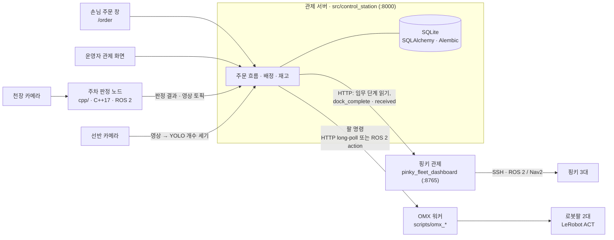

# 로봇 관제 시스템: 주문부터 로봇팔 적재, 이동 로봇 배송까지

손님이 주문한 물건을 **로봇팔 두 대**가 선반에서 집어 **이동 로봇(핑키) 위에 올리고**, 핑키가 **수령 구역까지 배송**한 뒤 주차장으로 돌아오기까지를 관제 서버 하나가 이끄는 시스템입니다.

핵심 원칙은 **"명령을 보냈다"와 "실제로 끝났다"를 구분하는 것**입니다.

- 다음 단계로 넘어가기 전에 앞 단계의 결과를 카메라 관측으로 확인합니다. 선반과 핑키 위 물건 개수, 천장 카메라가 본 핑키의 ArUco 마커 위치가 그 근거입니다.
- 결과가 불명확하면 추측해서 진행하지 않습니다. 그 자리에서 멈추고 운영자의 확인을 기다립니다.

## 목차

- [한눈에 보기](#한눈에-보기)
- [시스템 구성](#시스템-구성)
- [주문 한 건이 처리되는 순서](#주문-한-건이-처리되는-순서)
- [주요 기능과 설계 포인트](#주요-기능과-설계-포인트)
- [기술 스택](#기술-스택)
- [저장소 구조](#저장소-구조)
- [문서](#문서)

## 한눈에 보기

| 항목 | 내용 |
|---|---|
| 로봇 | 이동 로봇 Pinky Pro 3대(ROS 2 Jazzy, Nav2), OMX 로봇팔 2대(LeRobot ACT 정책) |
| 카메라 | 천장 카메라(핑키 도착 판정, 핑키 위 물건 세기), 선반 카메라(재고 세기), 팔마다 위·그리퍼 카메라(정책 입력) |
| 서버 | 관제 서버(포트 8000), 핑키 관제(포트 8765) |
| 언어 | Python(서버, 로봇 노드), C++17(주차 판정 ROS 2 노드), JavaScript(화면) |

## 시스템 구성



| 구성요소 | 위치 | 하는 일 |
|---|---|---|
| 관제 서버 | [src/control_station/](src/control_station/) | 주문 접수·배정·단계 실행·이력 저장, 카메라 YOLO 개수 세기, 관제 화면과 HTTP API |
| 핑키 관제 | [pinky_fleet_dashboard/](pinky_fleet_dashboard/) | 핑키 3대 주행준비(bringup·Nav2), 경로 주행, 구역 예약과 마주침 양보, 라이다·초음파 퓨전, 최종 속도 감시 |
| 주차 판정 | [cpp/](cpp/) | 천장 카메라의 ArUco 마커로 핑키가 등록 자리에 섰는지 판정하는 C++ 라이브러리와 ROS 2 노드 |
| 팔 워커 | [scripts/](scripts/) `omx_*.py` | 관제의 팔 명령을 받아 LeRobot ACT 정책을 실행하고 결과를 보고 |
| YOLO | [yolo/](yolo/) | 물체 검출 데이터 준비·학습 스크립트와 팀 모델 |
| 시뮬레이션 | [simulation/](simulation/) | Gazebo 창고 월드, 로봇 없이 주문 흐름을 돌리는 가상 핑키 관제 |

관제 서버와 핑키 관제는 HTTP로만 이야기합니다. 핑키 관제는 단계마다 토큰을 새로 발급해서, 늦게 도착했거나 다른 핑키에게 간 신호를 거절합니다.

## 주문 한 건이 처리되는 순서

1. **접수.** 손님 주문 창이나 관제 화면에서 물건 종류와 개수를 받습니다. 선반 재고에서 다른 주문이 예약한 수량을 뺀 만큼까지만 받습니다. (`orders/desk.py`, `orders/inventory.py`)
2. **배정.** 시작할 때 핑키, 수령 구역, 팔을 정하고 고른 이유를 함께 남깁니다. (`orders/assignment.py`)
   - 핑키: 배터리 구간 → 오늘 운행 수 → 쉰 시간 순으로 고릅니다.
   - 팔: 물체가 놓인 선반을 맡은 팔 가운데 집기 성공률이 높은 쪽을 고릅니다.
3. **선반 재고 확인.** 선반 카메라의 YOLO 개수가 주문 수량 이상인지 봅니다. (`cameras/counts.py`)
4. **핑키 적재 자리 도착.** 핑키 관제가 Nav2로 핑키를 적재 자리에 보냅니다. 천장 카메라가 핑키의 마커를 그 핑키의 등록 자리와 비교합니다. (`pinky/docking.py`, `cpp/`)
   - 어긋났으면 카메라가 잰 만큼 고쳐서 다시 들어오게 합니다. 최대 5번까지 시도하고, 그래도 어긋나 있으면 운영자 확인을 기다립니다.
   - 맞으면 도착으로 처리합니다.
5. **물체 하나씩 집기.** 배정된 팔이 그 물체용 ACT 정책으로 물체를 집어 핑키 위에 올립니다. (`arms/pick.py`)
6. **옮김 확인.** 집기 전과 비교해 선반이 1개 줄고 핑키 위가 1개 늘었는지 카메라로 확인합니다. 5~6단계를 물체 수만큼 반복합니다.
7. **총량 확인.** 핑키 위 종류별 개수가 주문과 같고 다른 물건이 섞이지 않았는지 봅니다.
8. **배송과 복귀.** 핑키에 출발 신호를 보냅니다. 수령 구역 도착 → 손님의 [받았어요] → 주차장 복귀까지 차례로 기다립니다.

어느 단계든 실패하면 그 자리에서 멈추고 자동으로 다시 시도하지 않습니다. 팔은 핑키 도착이 확인되기 전에는 움직이지 않습니다. 단계별 실패 코드와 모의/실제 경계는 [주문 흐름](docs/implementation/order-flow.md)에 정리되어 있습니다.

## 주요 기능과 설계 포인트

### 관제 서버

- **작업·단계·이벤트 이력.** 명령 접수, 장치 수락, 실행 진행, 최종 결과를 서로 다른 상태와 이벤트로 SQLite에 저장합니다. 스키마 변경은 Alembic 마이그레이션으로 관리합니다. (`storage/store.py`, `storage/models.py`, `migrations/`)
- **결과를 모르면 `UNKNOWN`으로.** 팔 명령은 팔마다 한 번에 하나만 열려 있습니다. 응답 제한 시간이 지나면 `UNKNOWN`으로 두고 자동으로 다시 보내지 않으며, 운영자가 현장을 확인하고 닫아야 그 팔이 다음 명령을 받습니다. (`arms/commands.py`)
- **흔들리는 카메라 개수 걸러내기.** 새 프레임 5장의 중앙값으로 개수를 셉니다. 재고는 같은 값이 3번 연속 나올 때만 확정하고, 팔이 일하는 동안에는 마지막 확정값을 유지합니다. (`cameras/counts.py`, `orders/inventory.py`)
- **자동 출발.** 기다리는 주문을 접수 순서대로 출발시킵니다. 재고 부족처럼 그 주문만의 문제면 건너뛰고, 멈춘 주문의 경보를 확인하기 전에는 아무 주문도 출발시키지 않습니다. (`orders/dispatcher.py`)
- **큰 주문 나누기.** 핑키 쟁반 용량을 넘는 주문은 운송분으로 나눕니다. 앞 운송분의 핑키가 주차장에 돌아오면 다음 운송분이 출발합니다. (`orders/planning.py`, `orders/flow.py`)
- **전체 정지.** 팔과 핑키에 한 번에 정지를 요청합니다. 소프트웨어 정지 요청이며 하드웨어 비상정지를 대신하지 않습니다. (`stop_all.py`)

### 핑키 관제

- **한 대씩 주행준비.** SSH로 로봇의 bringup·센서·Nav2를 띄우고, Nav2 lifecycle 노드가 모두 활성인지까지 확인합니다. (`nav_readiness.py`)
- **라이다로 자기 위치 찾기.** 라이다 스캔 한 번을 지도와 맞춰 위치 후보를 찾습니다. 경기장이 대칭이라 후보가 여럿이면 알려진 자리에 맞는 후보를 고르고, 그래도 모호하면 운영자가 고릅니다. (`scan_localizer.py`)
- **라이다·초음파 퓨전.** 로봇 둘레 2 m 확률 점유 격자(log-odds, 높이 두 층)에서 두 센서를 합칩니다. 라이다 평면보다 낮은 장애물을 Nav2 costmap에 넣는 것이 목적입니다. (`fusion_grid.py`, [설명](docs/implementation/sensor-fusion.md))
- **최종 속도 감시.** 평소 `/cmd_vel`을 내보내는 노드는 하나뿐이고, 라이다 점과 초음파로 충돌을 막습니다. 퓨전 노드가 죽어도 이 감시는 따로 동작합니다. (`velocity_guard.py`, `motion_gate.py`)
- **구역 예약과 양보.** 통로와 적재 자리는 예약으로 한 대씩만 들어갑니다. 두 대가 마주치면 정해진 우선순위에 따라 한 대가 물러납니다. (`traffic.py`, `yielding.py`)
- **상태 램프와 화면.** 핑키의 LED와 LCD에 지금 하는 일, 표정, 배터리를 보여 줍니다. (`status_lamp.py`, `status_display.py`)

### 주차 판정 (C++)

- 처음 Python으로 만든 판정을 C++17로 옮기고 ROS 2 컴포넌트로 감쌌습니다.
- 옮기기 전 Python 결과로 만든 기대값과 비교하는 테스트가 있습니다. 같은 영상 30초를 두 구현으로 동시에 판정했을 때 60/60이 같은 상태였고, 차이의 중앙값은 dx 1.0 mm, dy 1.3 mm, yaw 0.15°였습니다. ([cpp/README.md](cpp/README.md))
- 판정만 하고 로봇에 명령을 보내지 않습니다. `ARRIVED`는 "마커가 허용 범위 안에 있다"는 관측일 뿐, Nav2 이동 성공을 뜻하지 않습니다.

## 기술 스택

| 영역 | 사용 기술 |
|---|---|
| 관제 서버 | Python 3.10+, 표준 라이브러리 `http.server`(`ThreadingHTTPServer`), SQLAlchemy 2, SQLite, Alembic |
| 화면 | HTML, CSS, JavaScript (프레임워크 없음) |
| 로봇·통신 | ROS 2 Jazzy, Nav2, rclpy, domain_bridge, SSH |
| 비전 | OpenCV 4(ArUco, solvePnP, 카메라 보정), Ultralytics YOLO |
| 로봇팔 | LeRobot, ACT 정책 |
| C++ | C++17, ament_cmake, colcon, GTest, nlohmann-json |
| 시뮬레이션 | Gazebo Harmonic, ros_gz |
| 테스트 | pytest, unittest, GTest |

## 저장소 구조

```text
.
├── src/control_station/     관제 서버
│   ├── app.py               서버 조립과 요청 분배 (실행: python -m control_station.app)
│   ├── api/                 HTTP 경로별 처리 (경로 표는 api/routes.py)
│   ├── orders/              주문
│   │   ├── desk.py          접수·시작·거절
│   │   ├── assignment.py    핑키·팔·수령 구역 배정 규칙 (순수 함수)
│   │   ├── planning.py      큰 주문을 운송분으로 나누는 계획 값
│   │   ├── flow.py          주문 단계 실행
│   │   ├── task_runner.py   작업 실행과 적재 확인 (주문은 flow.py에 넘김)
│   │   ├── dispatcher.py    접수 순서대로 자동 출발
│   │   ├── inventory.py     선반 재고와 주문 가능 수량
│   │   └── progress_view.py 주문 진행 화면 요약
│   ├── arms/                로봇팔
│   │   ├── config.py        팔과 담당 선반, 팔마다 장치 경로
│   │   ├── commands.py      팔 명령 큐 (UNKNOWN, 자동 재전송 없음)
│   │   ├── pick.py          주문 집기 (HTTP 워커 또는 ROS 2 action)
│   │   └── policies.py      물체별 ACT 정책
│   ├── cameras/             카메라
│   │   ├── adapters.py      카메라 feed와 YOLO 검출
│   │   ├── counts.py        검출로 종류별 개수 세기
│   │   └── shelf_slots.py   선반 칸 정의와 칸 영역
│   ├── pinky/               핑키
│   │   ├── fleet_client.py  핑키 관제 HTTP 클라이언트
│   │   ├── docking.py       적재 자리 도착 판정과 진입 안내
│   │   └── parking_ros.py   주차 판정 노드 연결 (rclpy)
│   ├── storage/             SQLite 저장소, 상태 어휘, 설정 JSON 읽기
│   ├── mock_world.py        모의 세계
│   ├── stop_all.py          팔과 핑키 전체 정지 요청
│   └── web/                 관제 화면, 손님 주문 창
├── pinky_fleet_dashboard/   핑키 관제 (app.py, scripts/는 PC·로봇 쪽 노드)
├── cpp/                     주차 판정 C++ 라이브러리·ROS 2 노드, 팔 action 정의
├── scripts/                 카메라 보정, 팔 워커, 설치 확인
├── config/                  팔, 선반 칸, 정책, 수령 구역, 핑키 마커 설정
├── migrations/              Alembic 스키마 변경
├── tests/                   관제 서버 테스트
├── yolo/                    YOLO 데이터 준비·학습 스크립트, 팀 모델
├── simulation/              Gazebo 창고 월드, 가상 핑키 관제
└── docs/                    명세, 구현 현황, 실행 방법
```

## 문서

전체 목차는 [docs/README.md](docs/README.md)에 있습니다. 처음 읽는다면 아래 순서를 권합니다.

1. [주문 흐름](docs/implementation/order-flow.md): 주문 한 건의 단계, 핑키 관제 연결, 남은 일
2. [구현 현황](docs/implementation/current-state.md): 코드 위치와 API 목록
3. [시스템 명세](docs/spec/system-spec.md): 목표 동작과 필수 제어 규칙
4. [실행 방법](docs/implementation/runbook.md): 새 PC 환경 확인, 관제·카메라·팔·주차 판정 실행 절차
5. [개발 로드맵](docs/development-plan.md): 에픽 순서와 진행 상황
6. [개발 원칙](AGENTS.md): 이 저장소에서 지키는 구현·안전 원칙
