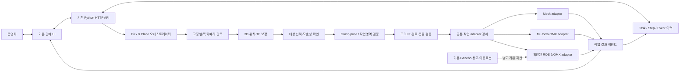

# 에픽 7 — 에피소드 없는 선반 물체 집기

## 목표

로봇 동작 에피소드를 수집하지 않고, 카메라로 선반 위의 지정 물체를 찾고 좌표를 계산해 로봇팔이 집는 제한된 작업 흐름을 만든다. 처음에는 **고정 카메라/선반 한 칸/대상 물체 하나/놓을 위치 하나**로 범위를 제한한다. 더 넓은 물체·배치 지원은 각 단계의 측정 결과를 확인한 뒤 확장한다.

에피소드 수집을 하지 않는다는 것은 인식 모델이나 설정이 필요 없다는 뜻은 아니다. 대상 종류에 따라 기존 사전학습 모델, 기준 이미지/기하 규칙 또는 별도 정지 영상 학습 중 무엇이 적절한지 관측 단계에서 선택한다. 로봇 명령 전에 장치 인터페이스와 좌표 변환을 검증한다.

## 현재 확인된 기반과 갭

| 영역 | 저장소에서 확인된 사실 | 남은 갭 |
|---|---|---|
| 카메라 | OpenCV 캡처와 MJPEG 표시가 있고, Head Camera는 기본 YOLO 검출을, Joint Camera는 `--arm`과 별도 가중치 설정 시 선택적 검출을 지원해 박스와 픽셀 중심 좌표를 표시한다. 이전 호스트 기록은 `/dev/video4`(Innomaker)를 Joint, HCAM0를 Head로 사용했다. 2026-10-31 현재 숫자 노드는 HCAM0 `/dev/video4`, Innomaker `/dev/video6`으로 재배정되어 by-id 기본 경로를 사용한다. | 실제 장착 위치와 선반을 보는 카메라가 무엇인지는 현장 육안 확인이 남아 있다. 깊이 정보, 시야/해상도, wrist-camera extrinsic 및 영상-관절 시간 정렬 조건도 미확정이다. |
| 인식 | 현재 YOLO 경로는 표시/API 조회 전용이며, Head Camera는 기본 탐색, Joint Camera는 `--arm`과 별도 가중치 설정 시 재관측 후보 표시를 지원한다. 현재 checkout에는 YOLO `.pt` 가중치가 없다. 후보 수·stale 상태 분류 API와 Head `DETECT_TARGETS`/Joint `REFINE_TARGET` step에 review link된 `TARGET_OBSERVED` 감사 이벤트가 있다. | 사용할 검증 모델과 첫 물체/시나리오가 정해지지 않았다. 관측은 `DETECT_TARGETS` step 완료 전이나 실행 신호로 연결되지 않는다. |
| 좌표 | 입력 좌표를 `DRAFT_ONLY` 파일로 저장하며, intrinsic/고정 평면 변환 초안 도구와 MuJoCo 전용 `link6` position-IK 후보 CLI를 마련했다. | 실측 보정·카메라→실물 OMX 변환·TCP orientation/collision을 검증한 IK 경로·물리 작업 영역이 없다. MuJoCo 선반은 placeholder다. |
| 팔 | 로컬 LeRobot OMX-F 소스에 현재 관절 관측과 `Goal_Position` 쓰기 인터페이스가 있다. 실제 모터 ID/model ping 및 read-only register query가 성공했다. | 자동 pick 작업 API, 안전한 물리 목표 한계, 실제 READY·정지·파지 완료/실패 신호가 확인되지 않았다. |
| 실행 이력 | Task/TaskStep/Event 저장 구조와 모의 실행 로드맵이 있다. | 인식·좌표 검증·집기·파지 확인을 연결하는 오케스트레이션이 없다. |

## 기존 시스템과의 통합 경계

새로운 독립 관제나 중복 ROS 2 제어 패키지를 만들지 않는다. 기존 Python 관제의 작업·단계·이벤트 저장, 카메라 API, UI, mock 모드를 재사용하고 필요한 기능을 확장한다. 작업 생성은 계속 저장과 상태 표시의 책임이고, 실제 실행은 명시적 시작 요청과 단일 작업 오케스트레이터가 맡는다. 기존 텔레오퍼레이션 프로세스 관리와 자동 Pick & Place 명령 adapter는 분리한다.

저장소의 `simulation/ros2_ws/src/toktak_warehouse`는 Gazebo Harmonic 창고/이동로봇 시뮬레이션 패키지다. bridge 설정에서 확인된 `/clock`, `/cmd_vel`, `/odom`, `/tf`, `/scan`, `/imu/data`, `/joint_states`는 해당 시뮬레이션의 토픽이다. 이것만으로 현재 실물 ROS graph, Nav2 action의 이름/타입, OMX ROS 제어 인터페이스를 확정하지 않는다. OMX arm용 ROS 2 패키지와 카메라 ROS driver는 현재 저장소에서 확인되지 않았다.

MuJoCo는 OMX 팔 기구학·그리퍼·접촉 동작을 검토할 후보이고, 기존 Gazebo 창고는 이동로봇/창고 환경의 기존 자산으로 남긴다. 두 시뮬레이터를 처음부터 하나의 런타임으로 묶지 않는다. 관제와 각각의 장치/시뮬레이터 사이에는 공통 작업·결과 계약을 두고, 실제 transport는 endpoint/type/result 의미를 확인한 adapter 안에 둔다.

점선 연결은 기존 Gazebo 자산과 장치 adapter가 현재 통합됐다는 뜻이 아니라, 조사 후 연결 가능성을 검토한다는 의미다. 인식/좌표/계획 단계의 결과는 매 단계 작업 이력으로 추적하고, mock·MuJoCo·hardware 출처를 UI에서 구분한다.

### 모듈 책임과 구현 경계

| 기능 | 우선 책임/재사용 위치 | 구현 경계 및 선행 확인 |
|---|---|---|
| 자연어 입력 및 작업 명세 | 기존 관제 API/UI와 Task 저장 구조 | 초기에는 검증 가능한 구조화 입력을 우선한다. LLM은 필드 추출까지만 사용하고 모터 명령/관절각을 생성하지 않는다. |
| 대상 인식 | 기존 `camera_adapters.py`의 관측 경로와 YOLO 결과 | 모델/색상·종류 적합성을 실제 물체로 확인한다. Grounding DINO/SAM 2는 현재 의존성이라고 가정하지 않고 필요한 경우에만 평가한다. |
| 3D 위치/TF | 기존 좌표 초안과 calibration 스크립트 | 카메라 RGB-D·장착 pose·frame·단위가 확인된 후 선택한다. RGB-only 고정평면 방식의 한계를 기록한다. |
| 대상 선택 | 관측 API의 후보 수·freshness 상태를 확장 | 복수 후보/불충분 신뢰도는 자동 임의 선택 없이 확인 요청 상태로 둔다. |
| Grasp planning | 규칙 기반 박스/병 초기 후보 | 물체 치수, 그리퍼 폭, 실물 관절/작업영역 근거를 확보하고 먼저 simulation에서 검사한다. |
| Motion planning | 기존 제어/IK 기능 존재 여부부터 조사 | Cartesian waypoint/기존 IK를 먼저 확인한다. MoveIt 2는 URDF/SRDF·solver·충돌장면 호환을 확인한 뒤 결정한다. |
| 실행/상태 | 기존 TaskStep/Event 및 adapter 경계 | 장시간 장치 실행은 확인된 ROS 2 action을 우선 검토한다. API 요청 접수와 장치 수락·진행·terminal 결과를 별개로 기록한다. |
| 관제 표시 | 기존 작업 이력 및 카메라 UI | 자연어 입력, 후보·위치, 단계·진행·취소·오류를 점진적으로 추가한다. 수동 제어와 자동 실행은 동시 제어되지 않도록 제어권을 관리한다. |

### 이 에픽의 작업 카드 기준

각 작은 구현 단위의 작업 계획에는 다음을 기록한다.

- 변경/추가 예정 파일과 기존 기능 재사용 근거
- 데이터 계약과 의존성, 새 외부 의존성이 필요한 이유
- mock 또는 시뮬레이션에서 결과를 확인하는 방법
- 성공 기준, 실패/미확정 결과 처리 및 실제 장치 차단 조건
- 문서 갱신 위치와 실물에서 확인되지 않은 사항

이 에픽에서는 먼저 분석 산출물과 mock/관측 경로를 완성한다. 실제 하드웨어의 움직임은 계획 문서의 일반 완료 조건에 포함하지 않으며, 장치 인터페이스 및 안전 기준 확인 후 별도 승인된 현장 절차로 다룬다.

저장소 문서에 적힌 장치 경로·라이브러리 계약은 기존 조사 기록이다. 현재 연결, 장치 준비 상태, 물리 안전성을 증명하지 않는다.

## 단계와 완료 기준

### 0. 작업 범위와 장치 조사 — 진행 중

- [x] 저장소 문서와 코드에서 카메라·OMX·좌표·현재 제어 경계를 확인한다.
- [x] 확인된 사실과 현장에서만 판정할 항목을 구분한다.
- [x] ROS 2 workspace의 package/launch/parameter/robot model/interface와 build/run 진입점을 목록화한다.
- [x] 관제 API·상태·이벤트·UI 흐름과 ROS 2/카메라/팔 adapter의 재사용 및 변경 경계를 문서화한다.
- [x] 저장소 정적 설정에서 확인한 topic/action/service와 실행 중 graph에서 확인할 목록을 분리한다.
- [x] MuJoCo 공식 모델과 기존 Gazebo workspace의 목적·중복·연결 경계를 문서화한다.
- [ ] 첫 대상 물체, 선반 칸, 놓을 위치, 작업 환경(조명/물체 배치)을 운영 시나리오로 고정한다.
- [ ] 현장에서 카메라의 물리 위치·방향, 선반 시야, 깊이 지원 여부와 동시 캡처 조건을 확인한다.
- [ ] OMX의 실제 제어 인터페이스, 현재 관절 상태/READY 신호, 물리 한계·정지 방법, 작업 완료·그리퍼 결과 신호를 확인한다.
- [ ] 기준 좌표계, 축 방향, 단위, 말단 프레임, IK 제공 경로와 허용 작업 영역을 확인한다.

**완료 기준:** 저장소 아키텍처, 기존 관제 재사용 지점, ROS 2 정적 인터페이스, 시뮬레이터 경계, 첫 시나리오 및 장치 조사표가 구분되어 기록된다. 각 미확정 항목에 확인 방법과 담당 주체가 있고, ROS runtime 확인과 현장 확인이 정적 저장소 분석과 구별된다. 이 단계에서는 팔 명령을 보내지 않는다.

**저장소 조사 결과:** 카메라 노드 번호는 2026-10-30에 Innomaker `/dev/video4`, HCAM0 `/dev/video6`으로, 2026-10-31에는 HCAM0 `/dev/video4`, Innomaker `/dev/video6`으로 관측됐다. 물리 장착 위치와 camera role은 미확인이다. OMX 관절 action key는 LeRobot 0.4.4 기본 정규화 표현으로 문서화됐으나 이는 물리 한계나 자동 pick API가 아니다. 좌표 초안 기능에는 IK/변환이 없고, 팔 완료 이벤트도 없다. 현장 장치에 관한 나머지 항목은 저장소만으로 확정할 수 없다.

**2026-10-30 읽기 전용 호스트 조사:** `v4l2-ctl --list-devices`에서 Innomaker-U20CAM-720P(`/dev/video4`, `/dev/video5`)와 HCAM0(`/dev/video6`, `/dev/video7`)이 보였다. `/dev/video4`와 `/dev/video6`은 현재 640×480 YUYV 캡처 모드로 보고됐으며 `/dev/video5`, `/dev/video7`은 메타데이터 노드다. 이 조회는 현재 모드만 확인했으며 지원 전체 포맷, 카메라 물리 장착 위치, 선반 시야, 깊이 데이터 의미는 확인하지 않았다. `/dev/omx_follower`, `/dev/omx_leader` symlink와 `/dev/ttyACM0`, `/dev/ttyACM1` 노드도 관측했지만, 직렬 포트를 열거나 팔에 명령을 보내지 않았고 장치 연결·준비 상태를 확인한 것으로 간주하지 않는다.

**2026-10-31 읽기 전용 카메라 재확인:** 현재 by-id 열거는 HCAM0를 `/dev/video4`, Innomaker U20CAM-720P를 `/dev/video6`으로 가리켰다. 두 device에서 V4L2 MJPG frame을 각 한 장 읽었다. Innomaker 이미지는 가까운 표면 위주였고 HCAM0 stream artifact는 JPEG로 decode되지 않아 어느 물리 위치인지 판단하지 않았다. Joint 기본 path를 기존 Innomaker 선택에 맞는 by-id로 바꿨으며, 같은 capture node가 두 slot에 설정되면 관제가 두 stream을 모두 열지 않도록 했다. 변경은 장치 번호 변동에 대한 경로 안정화이며 물리 역할의 확인은 아니다.

**ROS graph 읽기 전용 확인:** `/opt/ros/jazzy`의 기본 `ROS_DOMAIN_ID=0`에서 `/rosout`, `/parameter_events` 외 node/topic/action/service endpoint를 찾지 못했다. 저장소 Gazebo 런처는 domain 31을 기본 사용하며 이번 확인에서는 Gazebo를 시작하지 않았다. 따라서 domain 0 관측은 domain 31의 Gazebo나 다른 domain의 실제 장치 상태를 설명하지 않는다. 상세 명령과 해석은 [ROS 2 인벤토리](../implementation/ros2-inventory.md)에 기록했다.

**2026-10-30 실제 읽기 전용 관측:** 두 카메라에서 각 1장의 640×480 YUYV 프레임을 읽었다. Joint 화면은 목재 작업면을 향하고, Head 화면에는 어두운 수평 구조와 표시물이 보였다. 실제 장착 위치와 집기 작업 시야는 운영자가 최종 확인해야 한다. `/dev/omx_follower`에 대해 LeRobot OMX-F 모터 ID/model handshake가 성공했고, 6개 모터의 `Present_Position`, `Torque_Enable`, `Hardware_Error_Status`, `Operating_Mode`, 위치 register 범위와 전압 register를 `sync_read`했다. 당시 torque는 여섯 모두 0, hardware error는 여섯 모두 0, 다섯 관절 mode는 4, gripper mode는 5였다. 포트는 `disable_torque=False`로 닫았다. 팔 목표/설정 쓰기는 수행하지 않았다. 이 읽기는 순간 관측이며 `READY`, 비상정지 상태, 작업영역 안전, 실제 물리 한계를 증명하지 않는다. 모터 위치 register의 0–4095 읽음 범위는 집기 작업의 안전 한계로 쓰지 않는다.

**OMX 소스 계약 조사:** local LeRobot `OmxFollower.get_observation()`은 `Present_Position`을 읽고, `send_action()`은 `*.pos` 관절 목표를 `Goal_Position` register에 씁니다. `send_action()`의 상대 목표 제한은 config에 따라 비활성일 수 있고, terminal 파지 성공 신호는 확인되지 않았다. 고수준 `OmxFollower.connect()`는 보정 불일치 시 설정값을 쓸 수 있어 읽기 전용 점검에 사용하지 않는다. 저장소 checkout에는 YOLO `.pt` 가중치가 없어 모델 파일 없이 실제 검출 판정을 만들 수 없다.

### 1. 관측 전용 물체 인식

**구현 진행 (2026-10-31):** `GET /api/cameras`에 프레임 sequence/해상도와 YOLO 검출별 카메라 ID, 캡처 시각, 프레임 sequence, 중심/경계 픽셀 좌표 및 모델 클래스 목록을 연결했다. detector provenance에는 로드 가중치 SHA-256, confidence threshold, `imgsz`, 요청 device와 Ultralytics 버전을 기록한다. `GET /api/cameras/{camera_id}/target-observation?class_name=...` 및 현황 화면에서 검출기 오류/미준비, 모델에 없는 클래스, 카메라 연결 끊김/스트림 오류, stale/사용 불가 프레임, 후보 없음/단일/복수를 관측 상태로 구분한다. 최신 프레임과 일치하지 않는 검출은 후보 목록에서 제외한다. 선택적 `color` 조건은 후보별 보정되지 않은 HSV pixel hint 비교 상태/index를 표시하며 원 후보 배열을 유지하고 자동 필터·선택은 하지 않는다. 대기 task의 `pick_request.color`도 동일한 비교 결과를 관측 이벤트에 남긴다. 카메라 worker 시작 오류는 feed별로 격리하며, 실행 중 open/프레임 처리 오류는 상태를 기록한 뒤 재연결을 시도한다. 이는 관측만 하는 단계이며, 대상 물체별 정확도 검증·운영 시나리오 결정·좌표 보정은 아직 남아 있고 결과는 팔 제어와 연결되지 않는다.

**선택형 open-vocabulary detector (2026-10-31):** 기존 Ultralytics closed-set 경로는 유지하고, `CONTROL_STATION_HEAD_YOLO_WORLD_PROMPTS`와 명시된 local weights가 있을 때만 `YOLOWorld.set_classes()`를 호출하는 선택 모드를 추가했다. 카메라 worker의 상시 검출 vocabulary는 프로세스 시작 시 고정되고 모델 type·prompt·weights hash가 API에 포함된다. 대기 task의 `POST /api/tasks/{task_id}/target-observation`에서 요청 category가 그 vocabulary에 없으면 detector inference lock 안에서 요청 class 한 개를 일시 적용해 해당 raw frame을 one-shot 추론하고, `finally`에서 시작 vocabulary를 복원한다. `GET` 관측은 계속 고정 vocabulary의 읽기 전용 경로다. task event에는 고정/요청 prompt, `REQUEST_CLASS_ONE_SHOT` scope 및 `yolo-world-request-class-one-shot-v1` policy version을 분리해 기록한다. closed-set detector는 바뀌지 않는다. 이는 episode/fine-tuning 없는 요청별 class prompt 경로이지 prompt별 환경 성능 보장이 아니다. 저장소에 가중치가 없어 모델 load, prompt 복원 및 생활용품 검출 성능은 runtime에서 확인하지 않았다.

**MuJoCo fixed camera task detector 연결 (2026-10-31):** MuJoCo `FIXED` feed를 pending `DETECT_TARGETS` observation event에 연결했다. 기존 `CONTROL_STATION_HEAD_YOLO_*` 설정으로 선택적으로 detector를 background-load하고, ROS callback에서는 계속 RGB frame 보관만 한다. task observation POST가 특정 sequence/hash의 최근 raw frame을 검증해 closed-vocabulary 추론을 요청하고, detection에 camera ID·frame sequence/time/hash·pixel-transform provenance를 붙인다. open-vocabulary 모드에서도 동일 frame을 사용해 필요하면 task category one-shot prompt 경로를 재사용한다. frame provenance 불일치/만료는 다른 frame으로 바꾸지 않고 해당 관측 오류로 기록한다. task와 step 상태는 변하지 않고 ROS action/joint 명령도 보내지 않는다. synthetic frame과 stub detector로 provenance 성공/만료 거부를 확인했고, isolated MuJoCo ROS runtime의 실 API smoke에서 detector 미설정 상태의 `DETECTOR_NOT_CONFIGURED` event·`PENDING` task·`arm_command_sent: false`를 확인했다. 저장소에 weights가 없어 실제 모델 load와 detection 성능은 미검증이다. RGB-D depth 해석, segmentation, 3D localization, 고정 카메라 ROI 실측 및 grasp 실행은 다음 별도 작업이다.

**Joint Camera 관측 경로 (2026-10-31):** `CONTROL_STATION_JOINT_YOLO_WEIGHTS`가 명시되면 `--arm` 모드의 Joint Camera feed에도 독립된 YOLO detector를 연결하고, `CONTROL_STATION_JOINT_YOLO_WORLD_PROMPTS`로 선택적인 고정 vocabulary를 지정할 수 있다. detector class/provenance는 기존 camera snapshot 및 task observation 경로를 재사용한다. 자연어의 초기 shelf target vocabulary는 physical Head 또는 simulation FIXED camera의 ready detector class를 기준으로 삼는다. Joint Camera detector는 접근 전 후보를 다시 관측해 표시하는 경로일 뿐 선택/접근/파지 단계의 성공 신호가 아니다. 각 camera는 별도 model instance라 동시 활성화 시 추가 memory가 들며, 저장소에 가중치가 없어 실제 검출은 확인하지 않았다.

**선반 층 검토 비교:** `scripts/shelf_region_editor.html`은 저장된 원본 observation PNG에 층 polygon을 입력해 source PNG file SHA-256·해상도를 포함한 `regions.json` schema v2를 내보낸다. CLI는 이를 task event의 저장 이미지와 비교한 뒤 운영자 입력 polygon을 task/frame provenance와 연결한 `DRAFT_ONLY` artifact로 만든다. 브라우저 도구는 좌표 입력만 하며 물리 경계 측정이나 artifact 검토 승인을 하지 않는다. 관측 API는 운영자가 `{camera_id}.json`으로 명시적으로 배치한 artifact가 camera ID·해상도·`pixel_transform_id`와 일치할 때 후보 `center_px`의 requested shelf level 비교 상태/index를 기록한다. 영역 없음/source 불일치/경계·겹침 모호/층 일치 없음도 구분한다. artifact를 1 MB 이내로 온전히 읽으면 층 미설정·후보 없음·출처 불일치 등 비교 상태와 관계없이 JSON bytes의 SHA-256을 결과와 UI에 남겨 검사한 내용을 식별한다. ROI 결과는 자동 후보 선택에 쓰이지 않는다. `TARGET_SELECTED`는 pending `SELECT_TARGET` step에 `step_id`로 연결해 review 이력에 남기지만 단계 상태나 팔 제어를 바꾸지 않는다. 실제 측정 polygon과 독립 검토 프레임은 아직 없다.

**작업 요청과의 관측 연결:** 작업에 선택적 `pick_request`(category/color/shelf_level)를 저장하고, 대기 작업의 각 카메라 관측을 `TARGET_OBSERVED` task event에 기록한다. event는 요청 조건과 후보, frame/detector 출처를 보존하고 화면에서 카메라·판정·후보 수·색상/층 힌트 비교 결과·frame sequence를 보여준다. 색상 힌트와 요청 색상 비교는 각각 `hsv-inner-box-thresholds-v1`, `exact-estimated-hint-match-v1` 버전을 API/event에 보존하고, 관측 및 작업 이력 화면에도 표시한다. 후보 카드와 작업 이력은 추정 색상뿐 아니라 낮은 픽셀 비율·혼합색·계산 불가 상태도 보여준다. 이벤트 `step_id`는 Head 관측이면 pending `DETECT_TARGETS`, Joint 관측이면 pending `REFINE_TARGET`을 가리키며, review 단계 연결만 남기고 task/step 상태는 전이하지 않는다. Joint snapshot은 대기 중 카메라 preview이며 실제 접근 직전 재인식 증거가 아니다. 선택 기록은 pending `SELECT_TARGET` step에 연결하되 상태나 실행은 바꾸지 않는다. 색상 비교는 후보의 미보정 HSV hint를, 층 비교는 일치하는 활성 ROI draft의 polygon을 사용하지만 두 결과 모두 후보를 필터링하거나 자동 선택하지 않는다. 원본 PNG가 저장되고 hash가 확인된 event에서 사람은 후보 index를 명시적으로 `TARGET_SELECTED` review event에 기록할 수 있으며, 이는 task/step 상태·좌표 추정·팔 제어로 연결되지 않는다.

관측 snapshot에는 판정 status와 별도로 당시 `camera_connection_state`·`camera_stream_state`도 저장해 연결/스트림 오류의 원 상태를 감사 이력에서 확인할 수 있다.

**자연어 입력 초안:** `POST /api/tasks/parse-command`와 작업 이력 UI는 제한된 한국어 문형 및 일부 영어 물체/색상어에서 물체·색상·아라비아 숫자와 일부 한국어 서수 선반 층·목적지 표현을 폼에 옮긴다. `ready` 상태의 Head 또는 MuJoCo simulation fixed camera detector class label을 문장에 직접 쓴 경우 대조하고 상자/병 별칭도 모델 label에 연결한다. Head 또는 MuJoCo fixed camera가 ready YOLO-World일 때 vocabulary 밖 상자/병 별칭 또는 단일 한국어 목적격 대상구는 `REQUEST_PROMPT_REVIEW_REQUIRED` category 초안으로 채워 요청별 one-shot prompt 경로와 연결할 수 있다. 추출은 대상 검출을 뜻하지 않고 작업 폼의 사람이 검토·수정해야 한다. 오류·미준비/closed-set 카메라에서는 알 수 없는 범주를 자동으로 만들지 않는다. 복수 대상·수량, conjunction, 부정·대조 표현이 있는 대상구는 자동 채우지 않는다. detector class 불일치, 물체·색상·선반 층의 부정/제외, 목적지 대조/선택 표현은 누락/모호와 검토 필요를 표시한다. 단일 대상 MVP이므로 `두 상자`, `상자 두 개`, `상자들`과 같은 복수·수량 표현을 한 개로 축약하지 않는다. 색상·층 비교는 각각 미보정 hint/활성 ROI draft 기반의 검토 상태만 제공하며 자동 필터·선택은 하지 않는다. API는 task를 만들거나 명령을 보내지 않는다. 일반 영어 문장 parser나 LLM은 미구현이다.

- [x] task 관측 결과를 `TARGET_OBSERVED` event로 저장하고 작업 이력에서 추적한다. (2026-10-30)

- [x] 선반 영상과 검출 결과를 같은 프레임/시각 기준으로 표시한다.
- [x] 결과 계약에 물체 클래스, 신뢰도, 픽셀 위치/영역, camera ID, frame timestamp와 원본 해상도를 포함한다.
- [x] 대상 없음, 후보 복수/모호, stale 영상, detector 오류를 구분한다.
- [x] 카메라 연결/스트림 오류를 stale freshness와 별도로 구분하고 후보를 반환하지 않는다; 카메라 worker 실패는 관제 서버 전체를 중단시키지 않는다.
- 기존 모델 재사용, 기준 이미지/기하 규칙, 정지 영상 데이터로 모델 보완 중 최소 부담의 방법을 실제 물체로 비교한다.
- [x] 이 단계의 결과는 표시 전용이며 팔 명령을 만들지 않는다.

**완료 기준:** 사전 정의한 대상/배치에서 인식 결과를 사람이 확인할 수 있고, 모호하거나 오래된 결과가 거부되는 기준과 관측 성능 기록이 남는다.

### 2. 좌표 보정과 목표 검증

**구현 시작 (2026-10-30):** 저장된 체커보드 이미지로 OpenCV camera matrix와 왜곡 계수를 계산하는 오프라인 CLI, 측정 대응점으로 픽셀→고정 선반 평면 homography 및 독립 validation 잔차를 계산하는 CLI를 추가했다. 둘 다 `DRAFT_ONLY`이고 로봇 제어에는 사용할 수 없다. 실제 보정 이미지/대응점을 제공받지 않아 수치 결과나 품질은 아직 확인하지 않았다. 선반 평면→OMX 외부 변환과 목표 검증은 미구현이다.

`project_observation_to_shelf_plane.py`는 `TARGET_OBSERVED` event의 명시적 candidate bbox 하단 중앙 proxy를 일치하는 intrinsic/plane calibration에 투영해 2D plane draft를 남긴다. CLI index 입력은 frame-age 제한을 적용하고, 운영자가 고른 `TARGET_SELECTED` event는 동일한 candidate와 보관 PNG file/pixel hash를 검증해 오래된 캡처도 review-only 오프라인 초안으로 투영한다. 선택적 `--preview-output`은 원본을 수정하지 않고 bbox, proxy anchor와 평면 좌표를 표시한 검토용 사본 및 hash를 남긴다. 하단 중앙은 실제 지지점으로 검증된 값이 아니며 결과에 가정을 기록한다. task는 계속 PENDING이어야 하고 frame/class/camera/해상도/calibration ID를 교차 확인한다. 실측 calibration 및 검출 event가 없어 현재 실제 후보에는 적용하지 않았고 z나 OMX 좌표를 만들지 않는다.

**작업 이력 연결 (2026-10-31):** 명시적 `--record-review-event` 옵션은 저장된 새 projection JSON의 상대 경로와 SHA-256을 localhost API에 보낸다. API가 관리 디렉터리 범위, draft 계약/hash, 원본 plane/intrinsic calibration 파일 hash와 교차 참조, pending task, source observation/selection event 및 step provenance를 다시 확인하고 `TARGET_PLANE_PROJECTION_RECORDED`를 pending `ESTIMATE_TARGET_POSE`에 추가한다. 동일 초안 중복 제출은 저장소 transaction에서 기존 event/hash를 확인한다. 화면은 2D 좌표와 bbox 하단 중앙 proxy 및 로봇 목표 사용 불가 상태를 보여주며, event 옆 링크로 저장 JSON을 다시 hash 검증해 열 수 있다. 이 연결은 위치 추정 완료, 3D 위치 또는 파지 목표가 아니며 task/step 상태와 로봇 명령은 바꾸지 않는다.

**Simulation-only position IK:** `solve_mujoco_omx_position_ik.py`는 사용자가 직접 입력한 MuJoCo world 점을 대상으로 `link6` 원점의 XYZ 위치 IK 후보를 계산하고, 기본 home 또는 hash 검증된 이전 candidate 시작 자세·최종 자세·시작 후보에서 목표까지 이산 관절 선형 보간 sample의 contact pair를 표시한다. placeholder 물체 중심에서 1.799 mm 위치 잔차가 나왔지만 최종 자세에 shelf deck/support 및 로봇-물체 접촉이 있어 exit code 4로 표시됐다. 이산 sample은 연속 swept-path collision 검사나 planner가 아니다. position convergence는 유효한 파지 후보를 뜻하지 않고, 카메라 관측/보정 결과와 연결되지 않으며 tool orientation/grasp를 검증하지 않는다.

**단계별 상부 접근 관측 (2026-10-31):** 현재 placeholder 장면에서 세 번째 무접촉 waypoint로부터 hash-linked `link6` body-origin position chain을 계산해 `(0.05, 0.21, 0.32) m`까지 각 목표 잔차 1.552 mm 이하 및 81/101-segment sample 접촉 없음으로 도달했다. y=0.215/0.22 m에서는 위치 IK가 0.718/0.698 mm로 수렴했지만 link3와 shelf deck 접촉이 검출됐다. 이 chain은 link6 body origin을 대상으로 한 synthetic position 후보이며 TCP/그리퍼 방향, 연속 경로, dynamic tracking, grasp를 검증하지 않았다. placeholder 관측 한계는 [MuJoCo 기록](../implementation/mujoco-omx.md)에 상세히 둔다.

**후속 경로 표본 경계:** IK 도구에 `--max-path-joint-step-rad`를 추가해 보간 segment 수가 설정한 최대 joint 변화량을 넘지 않도록 하고, `--path-samples`는 최소 segment 수로 사용한다. 이 변경은 표본 간격을 제한하지만 continuous collision checking이나 동작 검증으로 승격하지 않는다. 현재 CLI는 관절 후보 사이 이산 경로 접촉을 보고한다.

**선택형 pose IK 후보:** 동일 CLI에 MuJoCo world-frame `link6` quaternion 입력과 방향 오차 허용치를 추가했다. 위치와 방향 잔차를 함께 푸는 오프라인 후보 경로이며 5-DOF 팔에서 6D pose 수렴을 보장하지 않는다. TCP frame 모드도 추가되어 MuJoCo `link6` 기준 변환을 명시 입력할 때 TCP 목표 pose와 TCP point Jacobian을 사용한다. 실물 측정 parent와 MuJoCo `link6` 간 대응 근거 및 유효 변환값은 아직 없고, 새 pose/TCP CLI 경로는 실행하지 않았다.

**기계 판독 후보 기록:** CLI에 `--format json`과 [출력 JSON Schema](../implementation/mujoco-ik-candidate.schema.json)를 추가했다. 현재 schema version 2는 목표/도달 pose, TCP transform/calibration provenance(사용 때), 잔차·허용치, 시작상태·관절값, 후보 관절, 위치·방향별 수렴 여부, 접촉 목록, 이산 경로 sampling, 모드별 상태, scene/model/assets SHA-256 및 이전 후보 시작상태의 hash를 기록한다. `--start-joints-json`은 버전·모델 source hash가 일치하고 수렴·무접촉인 prior candidate만 받아 waypoint 후보를 연쇄한다. Draft 2020-12 validator로 schema와 home→선반 앞 5개 segment의 payload를 확인했다. 실제 artifact가 없어 TCP artifact/pose 입력 CLI 경로는 아직 실행하지 않았으며, JSON 계약이나 hash 일치는 실물 제어 메시지·경로·파지 검증을 뜻하지 않는다.

**TCP artifact 사전 검사:** MuJoCo 의존성이 없는 `validate_link6_tcp_transform.py`를 추가해 `.control-station/omx-calibrations/` artifact와 두 local evidence file의 contract/hash를 확인한다. 현재 측정 자료가 없어 CLI는 실행하지 않았으며, 이 검사는 파일 무결성·형식만 확인한다.

**TCP artifact 입력 경로:** `create_link6_tcp_transform_draft.py`가 운영자의 실측 TCP 변환, 장치 revision, 검토된 frame mapping, uncertainty 및 두 관리 디렉터리 내 근거 파일을 받아 덮어쓰기 불가 `DRAFT_ONLY` JSON을 작성하도록 추가했다. 생성기는 frame 변환/측정 도구가 아니며 로봇 제어 사용을 항상 금지한다. 근거가 없어 생성/검증 CLI는 아직 실행하지 않았다.

기존 full-width front-support geometry를 사용한 추가 위치 표본에서는 선반에서 떨어진 임의의 네 점이 최종 접촉 없이 위치 수렴했지만, 이는 workspace의 일부 표본이다. 상자 바로 위의 두 점은 위치 잔차 기준으로 수렴하더라도 최종 deck 및 링크-물체 접촉으로 거부됐고, 더 높은 두 점은 수렴하지 않았다. 이후 sim 검토 편의를 위해 front support를 측면 모서리 지지대로 변경했으나, 이는 실물 선반 치수를 맞춘 변경이 아니다. 새 open-front scene에서도 물체 목표 IK의 종점/경로 접촉은 해결되지 않았다. 수치와 좌표는 [MuJoCo 초안](../implementation/mujoco-omx.md)에 기록했다.

- 카메라 intrinsic/extrinsic 및 이미지 전처리(회전/resize/crop) 영향을 기록한다.
- 깊이 카메라면 깊이 기반 3D 위치를 검토한다. RGB 전용이면 고정 선반 평면이라는 제한이 성립하는지 검토하며 물체 높이/가림 한계를 명시한다.
- 픽셀 또는 카메라 좌표에서 확인된 OMX 기준 frame으로 변환한다.
- 정지 기준점을 여러 위치에서 비교해 오차를 측정하고, 허용오차는 그리퍼/물체 크기와 장치 정밀도를 고려해 정한다.
- frame, 단위, calibration version, camera ID, frame 시각과 작업 영역 검증을 목표 데이터에 연결한다.

**완료 기준:** 측정 오차가 합의된 집기 허용 범위 안에 들고, 보정 누락·오래된 보정·작업영역 밖 좌표가 거부된다. 장치 제공 IK가 없으면 직접 IK 구현을 시작하기 전에 ROS 2/기존 라이브러리/LeRobot의 지원 여부를 확인한다.

### 3. 모의 pick 작업 흐름

**구현 진행:** `pick_request`를 포함한 작업에는 기존 transport 단계와 별도로 `DETECT_TARGETS → SELECT_TARGET → ESTIMATE_TARGET_POSE → VALIDATE_GRASP → APPROACH_TARGET → REFINE_TARGET → GRASP_TARGET → VERIFY_GRASP → LIFT_TARGET → MOVE_TO_DESTINATION → PLACE_TARGET → VERIFY_PLACEMENT` 단계 템플릿을 기록한다. 기본 mock worker는 이를 순서대로 `source: mock`, `SIMULATED_SUCCESS`로 진행하며, 선택적 `CONTROL_STATION_MOCK_FAIL_STEP`은 지정 step에서 오류 종결을 만들고 후속 단계를 미실행으로 남긴다. 실제 인식 결과, 좌표, grasp planning, MuJoCo joint 명령과 연결되지 않았다.

**RGB-D 후보 영역 raw 통계 (2026-10-31):** MuJoCo fixed camera manager는 최근 최대 5개/16 MiB depth frame을 보관하고, task observation의 RGB frame과 exact source stamp, frame ID, dimensions가 일치하며 depth가 2초 이내일 때만 detector bbox에 포함된 `32FC1`/`16UC1` raw 값의 finite-positive min/median/max 및 pixel counts를 후보별 review field에 추가한다. 요약에는 depth payload SHA-256, encoding/endian 및 frame provenance가 연결된다. 원본 depth payload는 API/event에 넣지 않으며 bbox 영역의 배경/가림 픽셀 가능성, depth 단위와 invalid-value 의미를 해결하지 않는다. 관제 UI는 수치를 raw encoding/단위 미해석과 위치·선택 미사용 상태로 표시한다. 이 단위는 RGB-D sample pair가 없는 경우 수치를 만들지 않고 상태를 기록하며 물체 3D 좌표, object pose, 후보 선택, task/step 진행 또는 로봇 명령을 생성하지 않는다. 변경 파일의 Python 정적 구문 확인만 했고 ROS runtime 및 실제 inference는 확인하지 않았다. 다음 localization 단계는 측정/검증된 CameraInfo·depth semantics, synchronization 기준, TF provenance를 정한 뒤 별도 구현해야 한다.

**MuJoCo 모델 확인 (2026-10-30):** MuJoCo 3.17에서 ROBOTIS OMX placeholder scene을 로드해 `nq=14`, `nv=13`, `nu=6`과 6개 semantic joint/actuator 이름 및 시뮬레이션 범위를 확인했다. 별도 CLI가 직접 radian 목표를 MuJoCo actuator에 적용하고 qpos를 출력한다. 초기 shelf placeholder와 home pose mesh가 깊게 충돌해 제한되던 관절 움직임을 scene placeholder 재배치로 해소했고, 제한된 `Joint1`, `Joint2` 목표 step을 headless 실행했다. `link6` 원점이 scene 물체 중심에 오도록 MuJoCo Jacobian 기반 position-only IK 후보도 계산했다. 이는 제한된 simulation 경로 확인이며, 관절별 정확도/전 범위/TCP orientation/충돌 회피/파지 성공 또는 실물 일치 검증이 아니다. LeRobot action→MuJoCo 변환·작업 경로 계획·집기 동작은 연결하지 않았다.

**MuJoCo 영상 입력 초안 (2026-10-31):** 임시 scene에 top-down `placeholder_fixed_camera`, baseline `link6` 부착 `placeholder_wrist_camera`, home 시점의 placeholder object를 향하는 별도 `placeholder_wrist_aimed_candidate`를 추가했다. MuJoCo 상태로부터 RGB PNG, metric depth, geom object ID/type segmentation을 만들고 artifact hash/shape/dtype, scene/mesh source hash, simulation joint 및 camera world pose manifest에 기록한다. schema v3 manifest는 각 camera parent body와 body 기준 local pose를 포함하며, verifier가 attachment 관계·정규화 quaternion을 확인한다. aimed quaternion은 home camera 위치와 placeholder box center로 계산된 simulation-only 후보이고 실물 장착 또는 ROS TF가 아니다. 640×480 schema v3 EGL capture에서 camera 3개·artifact 9개·scene source 10개가 verifier를 통과했다. `localize_mujoco_geom.py`는 fixed camera에서 target 1,764 pixel의 visible-surface mean을 placeholder box 윗면과 일치하는 world z=0.295 m로 출력했다. baseline wrist home view는 유효 positive-depth target pixel이 없었고, aimed candidate는 4,184 visible pixel을 얻었으나 RGB에서 shelf deck가 target 하단을 가렸다. 이전 1,000개 정적 자세 탐색에서도 온전한 비절단·무접촉 wrist view는 발견되지 않았다. capture와 시야는 임시 simulation viewpoint이며 실제 RGB-D 특성, ROS sensor topic, camera/extrinsic·접근/파지 동작을 확인한 것은 아니다.

**합성 3D 관측 초안:** `localize_mujoco_geom.py`는 위 verifier를 통과한 capture에서 지정된 geom segmentation과 metric depth를 결합해 visible-surface pixel 평균을 camera 및 MuJoCo world frame으로 역투영하도록 추가했다. 생성한 initial-keyframe capture에서 fixed camera target은 1,764 visible pixels와 world `[0.05, 0.25, 0.295] m` visible-surface mean을 냈고 placeholder box 윗면과 일치했다. Wrist camera에서는 그 자세에 target pixels가 없어 결과가 없었다. 출력은 물체 중심/크기/자세, base frame/TF, grasp 정보가 아닌 synthetic 관측 초안이며 실물/robot command에 사용할 수 없다.

**IK 후보 종점의 camera 검토 (2026-10-31):** `capture_mujoco_cameras.py --steps 0 --ik-candidate <candidate.json>` 경로가 scene source hash가 현재와 같고 수렴한 link6 후보를 static qpos로 렌더하도록 추가됐다. capture 시 MuJoCo가 종점 접촉을 다시 계산하고, 접촉이 있으면 렌더를 거부한다. schema v4는 candidate JSON 사본, hash/model source와 capture된 joint 값을 기록하며 verifier가 대조한다. staged `(0.05, 0.21, 0.32) m` link6 endpoint capture에서 candidate artifact 포함 10개 artifact와 10개 scene source가 통과했고, fixed camera의 1,353 visible target pixels가 관측됐다. 두 wrist view에는 유효 target depth pixel이 없어 localization이 거부됐다. 같은 결과가 front-edge부터 last-clean까지 다섯 hash-linked endpoint의 두 wrist view에서 반복됐다. 이는 현재 synthetic camera attachment와 표본으로 선택한 candidate endpoint의 결과이며 전체 자세 공간, wrist 재인식이나 실물 view를 입증하지 않는다.

**Wrist 가상 부착점 탐색 (2026-10-31):** `scripts/search_mujoco_wrist_camera_views.py`가 현재 scene source와 다섯 IK endpoint hash를 검증하고 link6 기준 60개 camera 위치 후보의 segmentation을 다섯 endpoint 모두에서 비교한다. 마지막 endpoint에서 placeholder object center를 향하도록 local optical quaternion을 계산해 각 후보에 고정했다. 52/60 위치는 다섯 자세 모두에서 target geom pixel을, 34/60은 각 target bbox가 320×240 frame edge에서 최소 5 px 떨어진 상태를 보였다. 상위 기록은 local position `[0.04,0.04,0.07] m`, quaternion `[0.52142,-0.16700,-0.01869,-0.83659]`이며 최소 target 2,587 px, 최소 edge margin 22 px다. 기록은 `.control-station/mujoco-wrist-view-candidates/candidate-20261030T202133121994Z-bbe004a1.json`에 저장된다. 이는 카메라가 link6에 달려 있다는 사실이나 해당 위치에 실물 카메라가 들어간다는 뜻이 아니다. 외형 크기, 케이블, 팔·선반 충돌, 물리 FOV, 센서 품질은 모델에 없으며 실제 장착 측정과 관측 전에는 제어에 사용할 수 없다.

**그리퍼 정적 접촉 기준선 (2026-10-31):** `scripts/inspect_mujoco_omx.py --gripper-mesh-distance`에서 다섯 그리퍼 각도의 jaw collision mesh 거리는 약 −1.8 mm이고 contact count는 0이었다. MJCF가 jaw 간 contact를 제외하므로 이는 그리퍼 개방폭이 아니다. 별도의 seed 고정 50,000 uniform qpos 표본에서 placeholder 물체 접촉은 475건, 양쪽 jaw 접촉은 136건이었고 jaw 두 개만 물체에 접촉한 상태는 1건이었다. 그 상태의 최대 penetration은 7.71 mm였고 jaw 평균 법선 내적도 −0.0094여서 반대면 pinch 휴리스틱(`dot ≤ −0.5`)을 통과하지 못했다. inspector CLI에 중심 관절/그리퍼 각도와 Gaussian 표준편차를 받는 지역 표본 옵션을 추가하고, seed `20261101`로 300,000개를 재실행했다. jaw-only 접촉 29,411개 중 반대 방향 법선 기준을 통과한 표본은 없었고, 가장 얕은 접촉도 약 0.028 mm penetration과 법선 내적 1.0을 보여 두 jaw가 같은 방향에서 물체를 눌렀다. 이 법선 기준은 기하 선별 휴리스틱이지 grasp 판정이 아니다. 모든 조사는 고정 freejoint 물체의 `mj_forward` 정적 기하이며 simulation step, 경로, 힘, lift 또는 실제 grasp를 확인하지 않았다. 재현 가능한 전역/지역 표본 조사 기준선은 생겼지만 접촉 형상은 여전히 placeholder 그리퍼/물체 모델의 한계 안에 있다.

**placeholder 물체 크기 조사:** 상자 반 크기 `[0.015, 0.025, 0.035] m`인 30/50/70 mm cube를 각각 MjSpec에서 재컴파일하고 상판을 0.5 mm 관통하는 정적 지지 자세로 두어 50,000개씩 조사했다. jaw-only 정적 접촉은 각각 `0/12/5,677`개였지만 반대면 법선 기준은 전부 0개였다. 70 mm cube의 최선 표본도 약 0.048 mm penetration, jaw-normal dot `0.997`로 양 jaw가 같은 면 방향을 향했다. 크기는 임의의 placeholder sweep이며 실제 물체 범위가 아니다. 크기 조정은 컴파일 뒤 geom array 직접 변경이 아닌 MjSpec 수정/재컴파일을 사용해 broadphase 충돌 누락을 방지한다.

**자세와 정적 접근 경로 후보:** 전역 uniform 1,000,000 qpos에서 4개 반대 법선 접촉을 찾았으나 penetration 6–13 mm로 깊었다. 해당 후보 주변 Gaussian 표본을 좁혀 50 mm cube의 `Joint1–5=[1.3257823,0.0678345,-1.0237959,1.5539147,-0.6059261] rad`, `Gripper=0.4896546 rad` 정적 접촉을 찾았다. 두 jaw contact의 최대 penetration은 약 `0.1093 mm`, 평균 target-to-jaw normal dot은 `−0.5067`이었다. 동시 관절 직선 경로는 선반 앞 지지대와 충돌했다. one-joint-at-a-time 순서 열거 중 9개 경로가 30 segments/joint에서는 환경/자기 충돌이 없었지만, 100 segments/joint 조사에서는 모두 endpoint 전에 target 접촉이 시작됐다. 그중 `Joint3→Joint1→Joint4→Joint5→Joint2`는 1,000 segments/joint, 총 5,001 qpos에서 환경/자기 충돌 표본 0, shelf support 외 target 접촉 16 sample을 보였다. 접촉은 마지막 관절 이동의 약 99.7% 지점에서 시작했고 최대 target penetration은 0.1093 mm였다. 이 정적 샘플링 결과는 연속 충돌 검사나 trajectory controller 실행이 아니며, gripper angle/opening 의미·힘 유지·lift·실제 grasp는 확인하지 않았다.

**동역학 집기 후보 감사:** `scripts/audit_mujoco_pick_dynamics.py`가 정적 joint 후보를 actuator target으로 순차 실행한 뒤 jaw 접촉과 link6 position-IK lift를 관찰한다. gripper close 단계에서는 link6/link7 양쪽 접촉이 있었지만, 30 mm lift goal 동안 box가 일시적으로 최대 `5.80 mm` 상승하고 최대 shelf-bottom clearance `5.56 mm`를 보인 뒤 두 jaw 접촉이 풀렸다. 1,500 lift step 중 양쪽 접촉은 322 step에서만 관찰됐고, settle 후 object z 상승은 약 `0.13 mm`, 최종 bottom clearance는 약 `−0.11 mm`로 상자가 shelf support에 놓였다. 이는 정적 pinch 후보가 동적 grasp가 아님을 보여주는 실패 기준선이다. 같은 조건에서 5/10/15 mm lift 목표도 확인했으며, settle 뒤 선반 이격은 각각 약 0.33/2.34/3.02 mm였지만 모두 두 jaw 접촉을 잃고 link6 한쪽 접촉만 남았다. CLI의 모든 output은 simulation-only이며 trajectory planning, continuous collision, stable grasp나 hardware command를 검증하지 않는다. 상세 재현 command와 측정 범위는 [MuJoCo 기록](../implementation/mujoco-omx.md)에 둔다.

**ROS 2 MuJoCo simulation control 경계:** 기존 Gazebo package를 건드리지 않고 `simulation/ros2_ws/src/omx_mujoco_sim`을 추가했다. controller-only URDF/Xacro는 MJCF joint 이름·limits와 일치하며 모델 geometry는 기존 installed MJCF scene에서만 가져온다. `mujoco_ros2_control` system interface, headless option, home keyframe, joint-state broadcaster 및 joint trajectory controller 설정을 포함한다. 노드/controller를 `/mujoco_omx` namespace에 두고 controller별 YAML을 Jazzy spawner에 전달하며, local joint-state topic을 simulation `robot_state_publisher`에 remap하고 TF frame에 `mujoco_omx/` prefix를 붙였다. ROS 2 Jazzy 환경에서 `colcon build --packages-select omx_mujoco_sim` 성공, Xacro expansion 성공, 6개 interface/actuator mapping·joint ranges·mimic 부호·installed model path의 정적 대조를 확인했다. `run_mujoco_sim.sh`는 숫자 domain 1–232만 허용하고 기본 domain 0, Jazzy setup, build overlay와 필요한 package index를 확인한 다음 해당 sim launch만 실행한다. domain 격리는 스크립트가 판정하지 않으므로 운영자가 실제 ROS graph 기준으로 확인해야 하며 launch는 아직 실행하지 않았다. 관제의 `CONTROL_STATION_ARM_TRAJECTORY_ACTION_NAME`은 명시 설정 때만 `FollowJointTrajectory` server discovery를 하고 goal을 보내지 않는다. 공식 MuJoCo ROS backend는 미설치이므로 launch, controller activation, joint-state/TF/action runtime을 확인하지 않았다. 이 package는 Python 관제 task 실행이나 실제 OMX hardware에 연결되지 않았다.

**관제 상태 표시 연결:** `src/control_station/robot_adapters.py`의 ROS 2 상태 adapter가 운영자가 명시 설정한 `sensor_msgs/msg/JointState` topic을 subscription-only로 읽고 최근 관측의 이름·position·수신 나이를 `/api/robots`에 제공하도록 확장했다. 토픽 미설정이 기본이며, 기존 inventory에서 이동 시뮬레이터에도 `/joint_states`가 있으므로 이름만으로 OMX source라 가정하지 않는다. UI는 최신 관측을 `관절 상태 관측`, freshness 초과를 `관절 상태 오래됨`으로 표시하고 이를 readiness/safety/명령 가능성으로 해석하지 않는다. MuJoCo plugin이 설치되지 않아 sim topic→관제 화면 runtime 경로는 아직 확인하지 않았다.

- 인식 후보 확인 → 좌표/작업영역 검증 → 접근 → 파지 → 후퇴 → 파지 확인 단계를 작업 이력에 표현한다.
- 모의 어댑터로 성공, 대상 없음, 후보 모호, stale camera, 좌표 오류, 장치 거절, timeout/결과 불명 경로를 재현한다.
- 각 명령/이벤트를 task/step/command ID로 연결하고 중복·오래된 결과를 무시한다.
- 실행 결과가 불명확하면 작업을 개입 필요로 두고 후속 명령을 중지한다.

**완료 기준:** UI와 이력에서 단계별 결과 및 중단 원인을 볼 수 있고, 실패/불명 뒤 자동 재전송이나 후속 동작이 없다.

### 4. 자동 팔 어댑터와 제한된 실물 시험

- 자동 작업은 텔레오퍼레이션 프로세스 관리와 분리한 어댑터로 구현한다.
- 실제 인터페이스가 확인된 뒤 명령 수락, 진행, terminal 성공/실패, 취소 결과를 공통 이벤트에 매핑한다.
- 먼저 물체 없는 저속 제한 동작을 운영자 감독 아래 확인하고, 다음에 고정 물체 하나를 대상으로 시험한다.
- 각 시도에서 인식·좌표·calibration 버전·명령 ID·결과·실패 사유를 추적한다.

**완료 기준:** 장치 상태/최종 결과 신호로 명령과 파지 성공을 구별하고, stale/모호/범위 밖 목표·통신 단절·timeout에서 안전하게 멈추는 것을 현장 절차로 확인한다. 실물 시험 전까지 모의 결과를 실물 결과로 표시하지 않는다.

### 5. 범위 확대와 운영 수용

- 반복 시험 데이터를 바탕으로 조명, 물체 방향, 복수 물체, 추가 선반 칸을 하나씩 확장한다.
- 각 확장 조건별 인식률, 좌표 오차, 집기 성공률 및 실패 유형을 별도 집계한다.
- 장치별 설정·보정 갱신·운영자 개입·안전 정지 절차를 runbook에 반영한다.

**완료 기준:** 명시된 대상/배치 범위와 한계, 합의된 성능 기준, 실패 시 수동 복구 절차가 문서화되고 범위별 수용 확인이 끝난다.

## 의존성과 진행 경계

- 관측 전용 인식은 팔 자동 제어와 독립적으로 시작할 수 있다.
- 신뢰할 좌표 변환은 카메라 물리 매핑, 보정 방법, OMX frame/단위/IK 경로가 확인돼야 한다.
- 실물 자동 집기는 OMX 명령·READY·최종 결과 신호와 허용 동작 범위를 확인하기 전에는 진행하지 않는다.
- task/step 상태, 취소·timeout·재시작 복구 기반은 기존 작업 이력 및 실패·복구 에픽과 정합성을 확인한다.
- 제품 요구사항의 시스템 명세와 구현 현황 문서는 계속 분리한다. 구현 범위가 확인되면 각각의 목표 계약과 실제 사실만 갱신한다.

## 이번 확인 지점

저장소 기반 ROS/MuJoCo 조사, 임시 apt overlay의 simulator-only runtime 및 fixed-camera task observation 경로는 기록된 범위에서 확인했다. 이는 실물 장착·센서 semantics·인식 모델 검증이 아니다. 다음 구현 gate는 운영자가 [현장 입력표](../implementation/field-measurement-sheet.md)에 첫 대상/선반/목적지 시나리오, 실제 카메라 역할과 RGB-D/timestamp 계약, OMX frame/단위/안전 한계, TCP 및 그리퍼 geometry의 측정값과 출처를 채우는 것이다. 현재 field measurement, 승인된 calibration 및 TCP/gripper artifact가 없으므로 placeholder 수치로 object-relative grasp 후보를 계산하지 않는다. 자료가 확보되면 schema/hash validator로 입력을 확인하고, 그 증거에 연결된 calibration·geometry draft 및 MuJoCo grasp/lift 검토를 다음 작은 단위로 진행한다.
