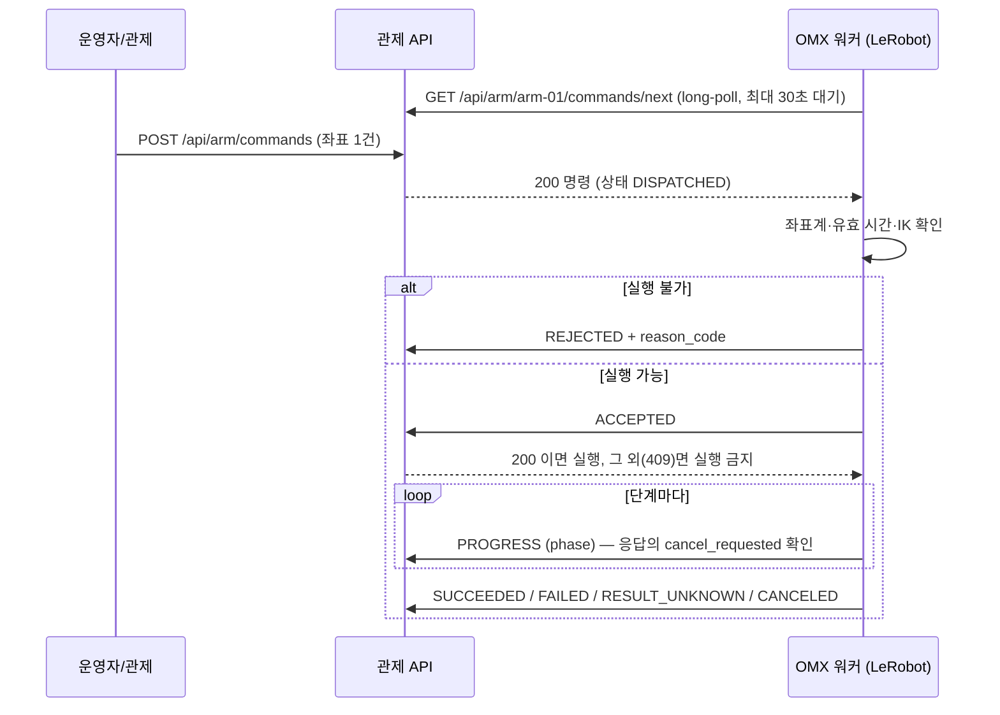

# OMX 명령 HTTP 인터페이스

관제가 OMX 목표 좌표를 넘기고, OMX 쪽 워커가 그것을 가져가 실행한 뒤 결과를 알려 주는 HTTP 계약입니다. 관제와 OMX가 한 노트북에 있든 서버와 노트북으로 나뉘든 같은 API를 씁니다. 관제는 팔을 직접 움직이지 않습니다. 팔을 움직이는 것은 OMX 쪽 워커(LeRobot)입니다.

현재 구현 범위: 명령 큐·상태 기록 API, 관제 화면의 **OMX 명령** 섹션(수동 조작 탭), 팔을 움직이지 않는 [모의 워커](../../scripts/mock_omx_worker.py). 작업 흐름(작업 이력의 단계)과는 아직 연결하지 않았고, 목표는 운영자가 직접 고릅니다(`source.kind: OPERATOR_INPUT`). 목표는 **선반 칸 하나**(`pick_slot_id`) 또는 **XYZ 좌표 하나** 중 하나입니다. 카메라 관측으로 칸·좌표를 정하는 경로와 실물 OMX 워커는 아직 없습니다.

## 왜 HTTP인가

- OMX는 LeRobot으로 제어하고, LeRobot은 ROS 2 노드가 아닙니다. 관제는 이미 HTTP 서버이고 작업·명령 기록 DB를 갖고 있습니다.
- 워커가 관제에 요청하는 방식(pull)이라 관제는 OMX PC 주소를 몰라도 됩니다. 워커 쪽은 Python 표준 라이브러리만 있으면 됩니다.
- ROS 2 action은 처음에는 OMX PC의 ROS 2 설치와 LeRobot 가상환경의 `rclpy` 사용 가능 여부를 몰라 보류했습니다. 2026-11-04 이 PC에서 둘 다 확인했고, 칸 이동만 먼저 action으로 옮기는 중입니다(아래 [ROS 2 action 워커](#ros-2-action-워커-omxmove_to_slot)). 관제 쪽 action 클라이언트는 아직 없으므로, 관제 화면에서 보내는 명령은 지금도 이 HTTP 계약을 씁니다.

## 전체 흐름



**핵심 규칙: 워커는 `ACCEPTED`에 HTTP 200을 받은 뒤에만 팔을 움직입니다.** 409나 연결 오류면 그 명령은 실행하지 않습니다. 이 규칙 덕분에 관제는 "ACCEPTED가 안 왔다 = 팔이 안 움직였다"로 판단할 근거가 생깁니다. 그래도 워커 버그 가능성 때문에 그 경우는 `UNKNOWN`으로 두고 사람이 확인합니다.

## 명령 (관제 → 워커)

워커가 `GET /api/arm/{robot_id}/commands/next`로 받는 `command` 객체입니다. 좌표는 명령을 만든 시점에 고정되며, 실행 중에 바뀌지 않습니다.

```json
{
  "schema_version": 1,
  "command_id": "CMD-E7792665603A",
  "robot_id": "arm-01",
  "operation": "PICK_AND_PLACE",
  "state": "DISPATCHED",
  "created_at": "2026-11-02T13:14:44.120000+00:00",
  "valid_until": "2026-11-02T13:15:44.120000+00:00",
  "worker_id": "omx-laptop",
  "cancel_requested": false,
  "target": {
    "object_class": "strawberry",
    "frame_id": "omx_link0",
    "unit": "m",
    "position": {"x": 0.21, "y": -0.05, "z": 0.12},
    "uncertainty_m": {"x": 0.01, "y": 0.03, "z": 0.01},
    "approach": "FRONT_HORIZONTAL"
  },
  "place": {"slot_id": "CART_1"},
  "source": {"kind": "OPERATOR_INPUT", "note": null}
}
```

예시 숫자는 형식 설명용이며 측정값이 아닙니다. 그 밖에 상태 확인용 필드(`dispatched_at`, `accepted_at`, `finished_at`, `last_event_at`, `reason_code`, `result` 등)가 함께 옵니다.

| 필드 | 의미 | 워커가 할 일 |
|---|---|---|
| `target.pick_slot_id` | 집을 선반 칸([칸 정의](#선반-칸-정의)의 사용 칸 6개 중 하나). 칸 명령이면 `frame_id`·`unit`·`position`·`uncertainty_m`은 `null`입니다 | 그 칸에 기록해 둔 관절 자세를 재생. 모르는 칸이면 `REJECTED` / `SLOT_UNKNOWN` |
| `target.slot_label`, `slot_map_version` | 칸 이름(예: "왼쪽 선반 아래 단 좌")과 명령을 만들 때 쓴 칸 정의 파일의 SHA-256 | 자기 칸 정의와 버전이 다르면 `REJECTED` / `SLOT_MAP_MISMATCH` |
| `target.frame_id` | 좌표 명령의 기준 프레임 이름. 관제는 이름만 전달하고 실제 프레임인지 확인하지 않습니다 | 자기 베이스 프레임(모의 워커 기본값 `omx_link0`)과 다르면 `REJECTED` / `FRAME_UNSUPPORTED` |
| `target.unit` / `position` | 항상 m. 관제는 ±1 m를 넘는 값만 막습니다(mm를 m로 잘못 쓴 경우 방지). 작업 범위 검사가 아닙니다 | 작업 범위·IK 실패면 `REJECTED` (`OUT_OF_WORKSPACE`, `IK_FAILED` 등) |
| `target.uncertainty_m` | 축별 신뢰 범위(선택). 정면 카메라는 깊이 축 오차가 큽니다 | 큰 축은 손목 카메라 재확인(`REFINE_TARGET`)으로 보정 |
| `target.approach` | 접근 방향. 현재 `FRONT_HORIZONTAL`만 정의 | OMX 팀이 다른 방식이 필요하면 값을 추가합니다 |
| `valid_until` | 이 시각 이후에는 실행하지 않음 | 지났으면 `REJECTED` / `EXPIRED` |
| `cancel_requested` | 운영자가 취소를 요청함 | 단계 사이에 확인하고 멈춘 뒤 `CANCELED` |

## 이벤트 (워커 → 관제)

`POST /api/arm/commands/{command_id}/events`

```json
{
  "event_id": "ACCEPTED-1f3a9c20",
  "robot_id": "arm-01",
  "worker_id": "omx-laptop",
  "event": "ACCEPTED",
  "simulated": false,
  "occurred_at": "2026-11-02T13:14:45.010+00:00",
  "phase": null,
  "reason_code": null,
  "message": null,
  "grasp_confirmed": null,
  "place_confirmed": null,
  "details": {}
}
```

- 필수: `event_id`, `robot_id`, `worker_id`, `event`, `simulated`. 실물 워커는 `simulated: false`를 명시합니다.
- `event_id`는 워커가 정합니다. 네트워크 오류로 같은 이벤트를 다시 보낼 때는 **같은 `event_id`**를 쓰면 한 번만 반영되고 `applied: false`로 응답합니다. 같은 `event_id`로 다른 이벤트를 보내면 409입니다.
- `worker_id`는 명령을 가져간 워커와 같아야 합니다.
- 응답 `200 {"command": ..., "applied": true}`의 `command.cancel_requested`로 취소 요청을 확인할 수 있습니다.

| event | 허용되는 현재 상태 → 다음 상태 | 조건 |
|---|---|---|
| `ACCEPTED` | `DISPATCHED` → `ACCEPTED` | 취소 요청됐거나 `valid_until`이 지났으면 409, 명령은 `CANCELED`/`EXPIRED`로 닫힘 |
| `REJECTED` | `DISPATCHED` → `REJECTED` | `reason_code` 필수 |
| `PROGRESS` | `ACCEPTED`/`RUNNING` → `RUNNING` | `phase` 필수 |
| `SUCCEEDED` | `ACCEPTED`/`RUNNING` → `SUCCEEDED` | `grasp_confirmed`와 `place_confirmed`가 모두 `true`일 때만 (SR-14) |
| `FAILED` | `ACCEPTED`/`RUNNING` → `FAILED` | `reason_code` 필수 |
| `RESULT_UNKNOWN` | `ACCEPTED`/`RUNNING` → `UNKNOWN` | 동작은 끝났지만 파지·적재를 확인할 수 없을 때. `reason_code` 필수 |
| `CANCELED` | `ACCEPTED`/`RUNNING` → `CANCELED` | 운영자 취소 요청이 있을 때만. 스스로 멈췄으면 `FAILED` |

`phase` 값은 관제의 집기 단계 이름과 같습니다: `APPROACH_TARGET`, `REFINE_TARGET`, `GRASP_TARGET`, `VERIFY_GRASP`, `LIFT_TARGET`, `MOVE_TO_DESTINATION`, `PLACE_TARGET`, `VERIFY_PLACEMENT`. `reason_code`는 대문자·숫자·`_`로 된 1–60자이며, 값 목록은 OMX 팀과 정합니다.

## 상태와 관제 규칙

| 상태 | 뜻 | 새 명령 |
|---|---|---|
| `QUEUED` | 워커가 아직 가져가지 않음. `valid_until`이 지나면 `EXPIRED` | 막힘 |
| `DISPATCHED` | 워커가 가져감. `CONTROL_STATION_ARM_ACK_TIMEOUT_S`(기본 10초) 안에 `ACCEPTED`/`REJECTED`가 없으면 `UNKNOWN` (`ACK_TIMEOUT`) | 막힘 |
| `ACCEPTED`, `RUNNING` | 실행 중. 결과 제한 시간은 아직 없으며 화면에 마지막 이벤트 시각을 표시합니다 | 막힘 |
| `SUCCEEDED`, `FAILED`, `REJECTED`, `CANCELED`, `EXPIRED` | 종료 | 가능 |
| `UNKNOWN` | 결과를 알 수 없음. 자동 재전송하지 않습니다 | 운영자가 현장 확인 내용을 기록할 때까지 막힘 |

- 팔 하나에 끝나지 않은 명령은 1건만 둡니다. 두 번째 명령은 409 `ARM_COMMAND_ACTIVE`입니다.
- `UNKNOWN`은 운영자가 화면의 **현장 확인 완료**(`POST .../clear-unknown`, 확인 내용 필수)를 눌러야 다음 명령을 보낼 수 있습니다. 결과는 계속 `UNKNOWN`으로 남고 성공·실패로 바꾸지 않습니다.
- 마감 시각 검사는 API를 호출할 때 함께 수행합니다. 화면이 1초마다 목록을 다시 불러오므로 표시는 거의 바로 바뀝니다.
- 워커의 long-poll 요청이 접속 신호 역할을 합니다. 화면 제목 옆에 "워커 대기 중" 또는 "마지막 접속 n초 전"을 표시합니다.

## API 목록

| Method | Path | 호출자 | 내용 |
|---|---|---|---|
| POST | `/api/arm/commands` | 관제 화면 | 명령 등록. body: `robot_id`, `operation`, `valid_for_s`(5–600), `target`, `place`, `source` |
| GET | `/api/arm/commands` | 관제 화면 | 최근 20건, 워커 접속 상태, ACK 제한 시간 |
| GET | `/api/arm/shelf-slots` | 둘 다 | 관제가 불러온 칸 정의 파일 내용과 버전(SHA-256). 파일이 없으면 404 `SHELF_SLOTS_NOT_CONFIGURED` |
| GET | `/api/arm/commands/{command_id}` | 둘 다 | 명령과 전체 이벤트 이력 |
| POST | `/api/arm/commands/{command_id}/cancel` | 관제 화면 | body `{}`. `QUEUED`면 바로 취소, 실행 중이면 취소 요청 표시 |
| POST | `/api/arm/commands/{command_id}/clear-unknown` | 관제 화면 | body `{"note": "..."}`. `UNKNOWN` 현장 확인 기록 |
| GET | `/api/arm/{robot_id}/commands/next?worker_id=...&wait_s=20` | 워커 | long-poll. 200 명령 / 204 없음. `wait_s` 0–30 |
| POST | `/api/arm/commands/{command_id}/events` | 워커 | 이벤트 보고 |

오류 응답은 `error_code`, `message`를 담습니다. 400은 형식 오류, 404는 없는 명령·팔, 409는 현재 상태에서 허용되지 않는 요청이며 409에는 현재 `command`가 함께 옵니다. 브라우저의 다른 출처(Origin) 요청은 403으로 막습니다.

## 선반 칸 정의

[config/shelf-slots.json](../../config/shelf-slots.json)은 팀 3D 모델(`shelf_a.glb`, `shelf_b.glb`)에서 [derive_shelf_slots.py](../../scripts/derive_shelf_slots.py)로 만든 칸 목록입니다. 모델에 들어 있는 칸 표시(`slot_<선반>_<단>_<번호>`, 각 단 바닥판 윗면의 칸 중앙)와 메시의 바닥판 면을 읽어, 두 선반을 하나의 선반 기준 좌표(`shelf_front`)로 표현합니다.

- 원점은 두 선반이 맞닿는 선의 밑면, 선반 정면 평면 위입니다. x는 선반 안쪽, y는 정면에서 볼 때 왼쪽, z는 위입니다. 높이는 선반 밑면 기준이며 책상 높이는 들어 있지 않습니다.
- 칸마다 칸 표시 위치(`marker_m`), 바닥판 영역(`footprint_m`), 바닥판 높이, 위 단까지 높이(`clear_height_m`, 위가 열려 있으면 `null`)를 담습니다.
- 사용하는 칸(`active: true`)은 6개로 정했습니다(2026-11-03): 왼쪽 선반 위 단 좌·우, 아래 단 좌·우, 오른쪽 선반 아래 단 좌·우. 오른쪽 선반 위 단(`slot_b_1_*`)은 모델에는 있지만 쓰지 않습니다.

| 칸 | `slot_id` | x | y | z (바닥판) | 물건 최대 높이 |
|---|---|---|---|---|---|
| 왼쪽 위 단 좌 | `slot_a_1_1` | 7.0 | 30.5 | 25.1 | 열림 |
| 왼쪽 위 단 우 | `slot_a_1_2` | 7.0 | 10.5 | 25.1 | 열림 |
| 왼쪽 아래 단 좌 | `slot_a_2_1` | 4.5 | 30.5 | 8.3 | 16.6 |
| 왼쪽 아래 단 우 | `slot_a_2_2` | 4.5 | 10.5 | 8.3 | 16.6 |
| 오른쪽 아래 단 좌 | `slot_b_2_1` | 4.5 | −10.5 | 8.3 | 16.6 |
| 오른쪽 아래 단 우 | `slot_b_2_2` | 4.5 | −30.5 | 8.3 | 16.6 |

단위는 cm이며 파일에는 m로 저장됩니다. 2026-11-03 자로 잰 실물은 폭 41 cm, 위 단 턱 위 27 cm로 모델과 같았지만, 아래 단은 모델보다 3.5 cm 낮았습니다(선반 밑면부터 아래 단 턱 위 약 10 cm, 모델 13.5 cm). 그래서 아래 단과 그 앞 턱에만 −3.5 cm 보정을 넣었고, 파일 `status`는 `MODEL_DERIVED_WITH_MEASURED_ADJUSTMENTS`, 보정 내역은 `measured_adjustments`에 남깁니다. 아래 단 바닥판은 8.3 cm, 아래 칸 높이는 16.6 cm가 됩니다. 정면 카메라 위치 보정에서 이 값으로 재투영 오차 1.3 px를 얻었고, 정면 카메라에서 `shelf_a`가 왼쪽인 것도 확인했습니다([선반 위치 보정](shelf-pose-calibration.md)). 깊이와 칸 좌우 위치는 실측하지 않은 모델 값입니다.

모델을 다시 받으면 이렇게 새로 만듭니다. 출력 파일이 있으면 `--force` 없이는 덮어쓰지 않습니다.

```bash
.venv/bin/python scripts/derive_shelf_slots.py shelf_a.glb shelf_b.glb \
  --inactive slot_b_1_1,slot_b_1_2 --force \
  --lower-deck-shift -0.035 --adjustment-note "2026-11-03 자 실측: …"
```

파일 내용이 바뀌면 버전(SHA-256)도 바뀝니다. 관제는 시작할 때 한 번 읽으므로(`CONTROL_STATION_SHELF_SLOTS`로 경로 변경 가능) 다시 시작해야 하고, OMX 워커의 칸별 자세도 새 버전 기준으로 다시 확인해야 합니다. 그 전까지 워커는 버전이 다른 명령을 `SLOT_MAP_MISMATCH`로 거부합니다. 파일을 읽지 못하면 관제는 좌표 명령만 받습니다.

## 실행해 보기

```bash
# 터미널 1: 관제 (모의 모드)
./run-control-station.sh

# 터미널 2: 모의 워커 (팔을 움직이지 않음)
.venv/bin/python scripts/mock_omx_worker.py --server http://127.0.0.1:8000
```

관제 화면 **수동 조작 → OMX 명령**에서 좌표를 넣고 **명령 보내기**를 누르면, 모의 워커가 받아 단계별 진행을 보고하고 "성공 · 모의"로 끝납니다. 다른 경로는 `--result failed|unknown|reject|silent`로 확인합니다. `silent`는 명령만 가져가고 `ACCEPTED`를 보내지 않으므로 10초 뒤 `UNKNOWN`이 됩니다. 좌표계를 `omx_link0`가 아닌 값으로 보내면 `FRAME_UNSUPPORTED`로 거부됩니다.

**OMX가 다른 PC에 있을 때:** 관제는 기본적으로 `127.0.0.1`에만 열립니다. 같은 네트워크의 노트북에서 접속하려면 `CONTROL_STATION_HOST=0.0.0.0`으로 실행하고, 워커는 `--server http://<관제 PC IP>:8000`을 씁니다. **인증이 없으므로** 믿을 수 있는 로컬 네트워크에서만 사용합니다. 관제 화면을 볼 수 있는 사람은 누구나 명령을 보낼 수 있습니다.

## 실물 OMX: 칸 앞으로 이동 (`MOVE_TO_SLOT`)

관제 쪽 범위는 **기록해 둔 칸 앞 자세로 팔을 데려가기**까지입니다. 집어서 넣는 동작은 LeRobot으로 학습한 정책이 이어받습니다(다른 파트). 그래서 워커는 명령을 처리할 때만 팔로워 포트를 열고, 도착하면 토크를 켠 채 포트를 놓습니다. 정책 프로그램은 그 자세에서 바로 같은 포트로 연결할 수 있습니다. 명령 종류 `MOVE_TO_SLOT`은 `target.pick_slot_id`가 필수이고 `object_class`는 비워도 됩니다. `SUCCEEDED`에는 측정한 관절값이 목표에 도착했다는 `pose_reached: true`가 있어야 합니다(`PICK_AND_PLACE`는 계속 파지·적재 확인이 필요).

환경 (2026-11-03, 이 PC): LeRobot 0.4.4 + Dynamixel SDK 3.8.4가 `~/lerobot-venv`에 있고, 팔로워는 OpenRB-150 `F58AE686…`(모터 ID 11–16), 리더는 `24D48EBF…`(ID 1–6)입니다. 포트는 꽂는 순서에 따라 `ttyACM` 번호가 바뀌므로 `/dev/serial/by-id/usb-ROBOTIS_OpenRB-150_F58AE686…-if00`을 씁니다. 계정이 `dialout` 그룹이어야 하며, 다시 로그인하기 전에는 `sg dialout -c "…"`로 실행합니다. 두 팔 모두 LeRobot OMX 공장 보정값(원점 보정 0, 위치 한계 0–4095)을 갖고 있음을 읽기 전용으로 확인했습니다.

1. **자세 기록** ([record_omx_pose.py](../../scripts/record_omx_pose.py), 읽기만 함): 팔로워 토크가 꺼진 상태에서 손으로 팔을 칸 앞 자세로 옮긴 뒤 실행합니다. `config/omx-slot-poses.json`에 다섯 관절과 그리퍼의 Dynamixel 위치값(1회전 4096)을 저장하고, 팔로워 보드 일련번호와 칸 정의 버전을 함께 남깁니다. 같은 이름을 다시 기록하려면 `--replace`.

   ```bash
   sg dialout -c "~/lerobot-venv/bin/python scripts/record_omx_pose.py slot_a_2_1"
   ```

2. **워커 실행** ([omx_lerobot_worker.py](../../scripts/omx_lerobot_worker.py)): `sg dialout -c "~/lerobot-venv/bin/python scripts/omx_lerobot_worker.py --server http://127.0.0.1:8000"`. 모터에 쓰지 않고 흐름만 보려면 `--dry-run`(실물 모터를 읽기만 함, 결과는 `RESULT_UNKNOWN`/`DRY_RUN_NO_MOTION`), 팔이 연결돼 있지 않으면 `--fake-follower`(이 프로세스 안의 가짜 모터가 프로파일 속도로 움직임, 모든 이벤트 `simulated: true`). 이동 로직과 안전장치는 ROS 2 워커와 함께 [omx_slot_motion.py](../../scripts/omx_slot_motion.py)에 있습니다.
3. **관제에서 명령**: **수동 조작 → OMX 명령**에서 명령 종류 "칸 앞으로 이동", 칸 선택, **명령 보내기**.
4. **좌표로 이동** (`MOVE_TO_POSITION`): 명령 종류 "좌표로 이동"에 좌표계 `omx_link0`와 X/Y/Z(m)를 넣습니다. 놓을 곳은 없습니다(`place: null`). 워커는 [omx_kinematics.py](../../scripts/omx_kinematics.py)의 계산식 IK로 **그리퍼 턱 부착점**(link6 원점, 실제 손가락 끝보다 안쪽)을 그 점에 두고 **손목을 수평**(`approach: FRONT_HORIZONTAL`)으로 맞추는 관절값을 구합니다. 손목 회전은 현재 값을 유지하고, 두 팔꿈치 해 중 현재 자세에 가까운 쪽을 고릅니다. 그다음은 칸 이동과 같은 검사(만료, 관절 변화량 한계)와 이동 절차를 거칩니다.
   - `omx_link0`: ROBOTIS OMX 모델의 받침 좌표계입니다. 원점은 팔 받침 바닥에서 어깨 회전축보다 1.125 cm 뒤이고, 앞(어깨 회전 틱 2048 방향) +x, 팔 기준 왼쪽 +y, 위 +z입니다. 링크 길이와 축은 [omx.xml](../../simulation/mujoco_omx/robotis_omx/omx.xml)에서 가져왔고 MuJoCo는 쓰지 않습니다.
   - 거부: 다른 좌표계 `FRAME_UNSUPPORTED`, 닿지 않음 `OUT_OF_REACH`, 모델 관절 범위 밖 `JOINT_LIMIT`, 다른 접근 방식 `APPROACH_UNSUPPORTED`.
   - **틱↔각도 변환은 가설입니다**: 각도 = (틱 − 2048) × 2π/4096, 모든 관절 같은 부호(ROBOTIS 관례, Drive_Mode 0). 기록한 두 칸 자세에서 좌우 방향은 맞아 보이지만 길이·높이는 실측하지 않았습니다. 정면 카메라 좌표(선반 기준)를 이 좌표계로 바꾸는 연결도 아직 없습니다.
   - 2026-11-04 확인: 계산식 IK가 정기구학을 거꾸로 정확히 풀어 기록 자세 틱을 그대로 돌려줌(테스트). 임시 관제에서 가짜 팔 워커로 `(0.20, 0, 0.15)` `SUCCEEDED`, `(0.60, 0, 0.10)` `OUT_OF_REACH`, `shelf_front` 좌표계 `FRAME_UNSUPPORTED`. 실물 팔 `--dry-run`으로 같은 좌표의 계획을 확인했습니다(최대 변화 173틱). 실물 이동은 아직 하지 않았습니다.
5. **원상복귀** (`RETURN_HOME`): 같은 섹션의 **원상복귀** 버튼. 명령에는 칸·좌표·놓을 곳이 없고(`target` 필드 모두 `null`, `place: null`), 워커가 자기 자세 파일의 `home`으로 갑니다. 안전장치와 성공 조건(`pose_reached: true`)은 칸 이동과 같습니다. `home`이 기록되지 않았으면 `POSE_NOT_RECORDED`로 거부합니다. API: `POST /api/arm/commands` body `{"robot_id": "arm-01", "operation": "RETURN_HOME", "valid_for_s": 60, "source": {"kind": "OPERATOR_INPUT"}}`. 2026-11-04 확인: 임시 관제에서 모의 워커와 `--fake-follower` 워커로 `SUCCEEDED`를 확인했습니다. 같은 날 관제 화면에서 실물 팔 원상복귀(`CMD-35E067AE79B9`, `--profile-velocity 5 --max-delta 1500`, 어깨 들기 1289틱 이동)가 `SUCCEEDED`였고 도착 오차는 최대 13틱이었습니다.

워커의 동작과 안전장치:
- LeRobot의 `OMXFollower` 대신 LeRobot Dynamixel 버스를 직접 씁니다. `OMXFollower.connect()`는 모터 설정을 다시 쓰고, 목표 위치를 맞추지 않은 채 토크를 켜기 때문입니다.
- `ACCEPTED`에 200을 받은 뒤에만 움직입니다. 토크를 켜기 전에 목표 위치를 현재 위치로 맞추고, 모터 자체의 속도 프로파일(`Profile_Velocity` 기본 10 ≈ 14°/s, `Profile_Acceleration` 기본 2 ≈ 43°/s², 약 0.3초에 걸쳐 가속·감속)로 천천히 움직입니다. 처음 쓴 15/10은 실물에서 출발·정지가 너무 급했습니다. 그리퍼는 명령하지 않습니다.
- 어느 관절이든 변화량이 `--max-delta`(기본 1200 = 약 105°)를 넘으면 `TARGET_TOO_FAR`로 거부합니다. 자세가 기록되지 않았으면 `POSE_NOT_RECORDED`, 칸 정의 버전이 다르면 `SLOT_MAP_MISMATCH`입니다.
- 다섯 관절이 목표에서 `--tolerance`(기본 15틱 ≈ 1.3°) 안에 들어오고 `Moving`이 0이면 `SUCCEEDED`, `--move-timeout`(30초)을 넘기면 그 자리에 멈추고 `FAILED`/`MOVE_TIMEOUT`, 통신 오류면 멈추고 `RESULT_UNKNOWN`입니다. 관제에서 취소하면 1초 안에 그 자리에 멈추고 `CANCELED`입니다.
- 관절 공간에서 바로 이동하므로 경로 중간의 선반 충돌을 검사하지 않습니다. 시작 자세와 목표 자세 사이에 선반이 없게 기록하고, 현장에서 전원을 끊을 수 있게 지켜봅니다.
- 이동 후와 워커 종료 후에도 토크를 켜 둡니다(팔이 떨어지지 않게). 손으로 다시 옮기려면 팔을 받친 채 `--release-torque`로 토크를 끕니다.
- 다른 프로그램(학습 정책, 텔레오퍼레이션)이 포트를 쓰고 있으면 모터에 아무것도 보내지 않고 `REJECTED`/`FOLLOWER_PORT_UNAVAILABLE`로 거부합니다.
- 2026-11-03 확인: `--dry-run`으로 관제 명령 → 검사 → 수락 → 쓰기 순서(목표=현재 → 속도 → 토크 → 목표)와, 명령 전후에 포트를 놓는 것까지 확인했습니다. 같은 날 현장 감독 하에 관제에서 `MOVE_TO_SLOT`(`slot_a_2_1`)을 보내 실물 팔로워가 쉬는 자세에서 기록 자세까지 움직였습니다. 가장 큰 이동은 어깨 들기 978틱(약 86°)이었고, 도착 오차는 최대 10틱(약 0.9°)으로 `SUCCEEDED`였습니다(`CMD-804B25BCB2B0`). 기록하지 않은 칸(`slot_a_2_2`) 명령은 움직이지 않고 `POSE_NOT_RECORDED`로 거부됐습니다. 경로 중 충돌 검사는 없으며, 나머지 칸 자세는 아직 기록하지 않았습니다.

### 좌우 보정 (선택, `--lateral-correction`)

칸 자세는 칸 중심을 향해 기록합니다. 물건이 칸 안에서 좌우로 치우쳐 있으면, 정면 카메라가 본 좌우 위치만큼 **어깨 회전 관절만** 돌려 보정할 수 있습니다. 나머지 관절과 깊이·높이는 기록 자세 그대로이고, 마지막 위치는 학습 정책이 맞춥니다.

- 관제: "정면 캠으로 칸 찾아 이동"으로 만든 명령에 `target.lateral_offset_m`(칸 중심선에서 왼쪽 +, 오른쪽 −, m)과 `target.object_position_shelf_m`이 들어갑니다. 검출 바닥점을 그 칸의 바닥판 높이 평면에 투영해 구합니다. 2026-11-03 보정으로 알려진 모서리 4개를 다시 투영해 보니 좌우 오차는 0–6 mm, 깊이 오차는 최대 1.5 cm였습니다. 그래서 깊이는 쓰지 않습니다. 이 계산에는 렌즈 보정값이 들어간 위치 보정 결과(`intrinsics` 포함, 2026-11-03 `8cd8caff`)가 필요하고, 그 전 결과로는 좌표가 `null`입니다.
- 워커: 어깨 회전축에서 칸 중심을 보는 방향과, 같은 깊이에서 좌우로 `lateral_offset_m` 떨어진 점을 보는 방향의 각도 차이만큼 `shoulder_pan`을 더합니다(`scripts/omx_lateral_correction.py`). `--max-lateral-degrees`(기본 10°)를 넘으면 `LATERAL_CORRECTION_TOO_LARGE`로 거부합니다. 결과 `details.lateral_correction`에 보정량이 남습니다.
- 필요한 현장 측정 `config/omx-base.json`: 선반 담당 OMX의 어깨 회전축 위치(선반 기준, m)와 회전 방향 부호입니다. 값이 없거나 부호가 확인되지 않으면 워커가 시작하지 않습니다.

  ```json
  {
    "schema_version": 1,
    "pan_pivot_shelf_m": {"x": -0.20, "y": 0.30},
    "pan_sign": 1,
    "note": "x는 선반 앞면에서 안쪽이 +(OMX가 앞에 있으면 음수), y는 두 선반 이음새에서 정면 기준 왼쪽이 +. pan_sign 1 = 모터 값이 늘면 위에서 볼 때 반시계(왼쪽)로 회전"
  }
  ```

  숫자는 형식 예시이며 측정값이 아닙니다. `pan_sign`은 실물에서 작은 보정으로 방향을 먼저 확인하고 정합니다.
- 2026-11-04 상태: 계산과 투영은 테스트로만 확인했습니다. OMX 회전축 위치는 아직 재지 않았고 실물 시험도 하지 않았습니다.

## ROS 2 action 워커 (`/omx/move_to_slot`)

같은 칸 이동을 ROS 2 action으로 받는 워커입니다. 관제(또는 `ros2 action send_goal`)가 action 클라이언트, [omx_ros_worker.py](../../scripts/omx_ros_worker.py)가 action 서버입니다. 이동 로직과 안전장치는 HTTP 워커와 같은 [omx_slot_motion.py](../../scripts/omx_slot_motion.py)를 씁니다. 메시지 정의는 [cpp/omx_interfaces/action/MoveToSlot.action](../../cpp/omx_interfaces/action/MoveToSlot.action)입니다.

- 목표: `command_id`, `slot_id`, `slot_map_version`(칸 정의 SHA-256), `object_position`(`geometry_msgs/PointStamped`, `shelf_front`, `frame_id`가 비면 없음), `lateral_offset_m`(NaN이면 없음), `valid_until`(필수, 0이면 `VALID_UNTIL_MISSING`).
- 진행: `phase: MOVING`, 관절 이름, 현재 관절값, 목표와의 최대 오차. 첫 진행은 목표 위치를 쓰기 **직전**에 보냅니다. 따라서 첫 진행이 오기 전에는 팔이 움직이지 않습니다.
- 결과: `outcome`(`SUCCEEDED`/`FAILED`/`RESULT_UNKNOWN`/`CANCELED`/`REJECTED`), `pose_reached`, `reason_code`, `message`, 최종 관절값, 최대 오차, `pan_correction_degrees`(NaN이면 보정 안 함), `simulated`.
- ROS 상태: `SUCCEEDED`만 succeeded, 취소는 canceled, 나머지(검사 거부 포함)는 aborted입니다. 판단은 `outcome`과 `pose_reached`로 합니다.
- 한 번에 목표 하나만 받습니다. 이동 중에 온 목표는 ROS 단계에서 받지 않습니다(`Goal was rejected`). 결과가 불명확해도 워커가 다시 시도하지 않습니다.

```bash
cd cpp && colcon build --packages-select omx_interfaces && cd ..   # 처음 한 번
source /opt/ros/jazzy/setup.bash && source cpp/install/setup.bash
export ROS_DOMAIN_ID=87 ROS_AUTOMATIC_DISCOVERY_RANGE=LOCALHOST
sg dialout -c "~/lerobot-venv/bin/python scripts/omx_ros_worker.py"      # 실물 팔
~/lerobot-venv/bin/python scripts/omx_ros_worker.py --fake-follower      # 팔 없이 (모의)

# 다른 터미널 (같은 source/export 후)
ros2 action send_goal --feedback /omx/move_to_slot omx_interfaces/action/MoveToSlot \
  "{command_id: TEST-1, slot_id: slot_a_2_1, slot_map_version: $(sha256sum config/shelf-slots.json | cut -d' ' -f1), \
    lateral_offset_m: .nan, valid_until: {sec: $(( $(date +%s) + 60 ))}}"
```

`ros2 action send_goal`은 Ctrl+C로 끊어도 취소를 보내지 않았습니다(Jazzy, 2026-11-04). 취소는 action 클라이언트 코드에서 `cancel_goal_async()`로 시험했습니다. Ctrl+C를 누르면 취소를 보내는 클라이언트 [omx_move_to_slot_client.py](../../scripts/omx_move_to_slot_client.py)와 단계별 실습 절차는 [OMX 팔 ROS 2 단계별 실습](omx-ros-practice.md)에 있습니다.

2026-11-04 확인 (`--fake-follower`만, 팔 미연결): `slot_a_2_1` 이동 `SUCCEEDED`(`simulated: true`)를 확인했습니다. 기록 안 된 칸, 만료, 칸 정의 다름, 유효 시각 없음, 다른 좌표계는 `REJECTED`였고 진행 메시지 없이 끝났습니다. 이동 중 두 번째 목표는 ROS가 거부했고, 이동 중 취소는 그 자리에 멈춘 뒤 `CANCELED`였습니다. 같은 날 HTTP 워커도 공용 모듈로 바꾼 뒤 `--fake-follower`로 임시 관제에 붙여 `POSE_NOT_RECORDED` 거부와 `SUCCEEDED`를 다시 확인했습니다. **실물 팔과 관제 action 클라이언트는 아직 시험하지 않았습니다.**

## 실물 워커를 만들 때 (OMX 팀)

[mock_omx_worker.py](../../scripts/mock_omx_worker.py)가 틀입니다. 표준 라이브러리만 쓰므로 LeRobot 가상환경에서 그대로 실행됩니다.

1. `check()`에서 좌표계, `valid_until`, 작업 범위, IK 해 존재 여부를 확인하고 문제가 있으면 `REJECTED`를 보냅니다.
2. `execute_phase()`에 IK와 LeRobot `send_action`(관절 목표)을 넣습니다. LeRobot OMX는 관절 목표만 받으므로 XYZ→관절 변환(IK)이 워커 쪽에 필요합니다.
3. 모든 이벤트에 `simulated: false`를 보냅니다.
4. 파지와 적재를 모두 확인한 경우에만 `SUCCEEDED`, 확인 수단이 없으면 `RESULT_UNKNOWN`을 보냅니다.
5. 이벤트 POST가 200이 아니면(특히 `ACCEPTED`) 그 명령을 더 진행하지 않습니다.
6. 텔레오퍼레이션과 워커를 동시에 켜지 않습니다. 같은 모터 포트를 두 프로그램이 쓰게 됩니다.

## 남은 일

- 정면 카메라 관측으로 칸을 판정해 명령 만들기 (`source.kind: CAMERA`, 카메라 ID·프레임 hash·칸 영역 버전 포함)
- 실물 선반 치수·배치 확인, OMX 베이스의 선반 기준 위치 측정(칸 좌표 → OMX 좌표)
- 작업 흐름 연결: 도착 확인(`VERIFY_ARRIVAL`) 통과 뒤 명령 생성, `PROGRESS`를 단계 상태로 반영
- 실행 중 결과 제한 시간과 그때의 처리
- `reason_code` 목록과 `approach` 값을 OMX 팀과 확정
- 원격 배포 시 인증
