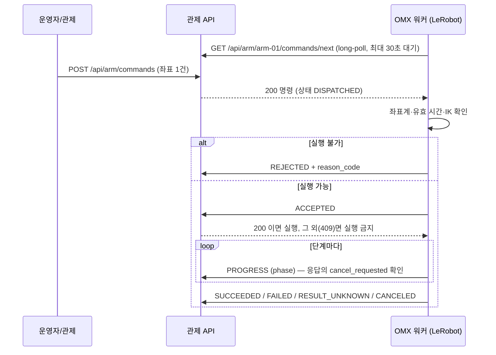

# OMX 명령 HTTP 인터페이스

관제가 OMX 목표 좌표를 넘기고, OMX 쪽 워커가 그것을 가져가 실행한 뒤 결과를 알려 주는 HTTP 계약입니다. 관제와 OMX가 한 노트북에 있든 서버와 노트북으로 나뉘든 같은 API를 씁니다. 관제는 팔을 직접 움직이지 않습니다. 팔을 움직이는 것은 OMX 쪽 워커(LeRobot)입니다.

현재 구현 범위: 명령 큐·상태 기록 API, 관제 화면의 **OMX 명령** 섹션(수동 조작 탭), 팔을 움직이지 않는 [모의 워커](../../scripts/mock_omx_worker.py). 작업 흐름(작업 이력의 단계)과는 아직 연결하지 않았고, 좌표는 운영자가 직접 입력합니다(`source.kind: OPERATOR_INPUT`). 카메라에서 계산한 좌표를 넣는 경로와 실물 OMX 워커는 아직 없습니다.

## 왜 HTTP인가

- OMX는 LeRobot으로 제어하고, LeRobot은 ROS 2 노드가 아닙니다. 관제는 이미 HTTP 서버이고 작업·명령 기록 DB를 갖고 있습니다.
- 워커가 관제에 요청하는 방식(pull)이라 관제는 OMX PC 주소를 몰라도 됩니다. 워커 쪽은 Python 표준 라이브러리만 있으면 됩니다.
- ROS 2 action도 검토했지만, OMX PC의 ROS 2 설치와 LeRobot 가상환경의 `rclpy` 사용 가능 여부가 확인되지 않았고 별도 `.action` 패키지를 두 PC에서 빌드해야 해서 보류했습니다. 아래 필드는 action의 goal/feedback/result로 1:1 옮길 수 있습니다.

## 전체 흐름



**핵심 규칙: 워커는 `ACCEPTED`에 HTTP 200을 받은 뒤에만 팔을 움직입니다.** 409나 연결 오류면 그 명령은 실행하지 않습니다. 이 규칙 덕분에 관제는 "ACCEPTED가 안 왔다 = 팔이 안 움직였다"로 판단할 근거가 생깁니다. 그래도 워커 버그 가능성 때문에 그 경우는 `UNKNOWN`으로 두고 사람이 확인합니다.

## 명령 (관제 → 워커)

워커가 `GET /api/arm/{robot_id}/commands/next`로 받는 `command` 객체입니다. 좌표는 명령을 만든 시점에 고정되며, 실행 중에 바뀌지 않습니다.

```json
{
  "schema_version": 1,
  "command_id": "CMD-E7792665603A",
  "robot_id": "arm-01",
  "operation": "PICK_AND_PLACE",
  "state": "DISPATCHED",
  "created_at": "2026-11-02T13:14:44.120000+00:00",
  "valid_until": "2026-11-02T13:15:44.120000+00:00",
  "worker_id": "omx-laptop",
  "cancel_requested": false,
  "target": {
    "object_class": "strawberry",
    "frame_id": "omx_link0",
    "unit": "m",
    "position": {"x": 0.21, "y": -0.05, "z": 0.12},
    "uncertainty_m": {"x": 0.01, "y": 0.03, "z": 0.01},
    "approach": "FRONT_HORIZONTAL"
  },
  "place": {"slot_id": "CART_1"},
  "source": {"kind": "OPERATOR_INPUT", "note": null}
}
```

예시 숫자는 형식 설명용이며 측정값이 아닙니다. 그 밖에 상태 확인용 필드(`dispatched_at`, `accepted_at`, `finished_at`, `last_event_at`, `reason_code`, `result` 등)가 함께 옵니다.

| 필드 | 의미 | 워커가 할 일 |
|---|---|---|
| `target.frame_id` | 좌표 기준 프레임 이름. 관제는 이름만 전달하고 실제 프레임인지 확인하지 않습니다 | 자기 베이스 프레임(모의 워커 기본값 `omx_link0`)과 다르면 `REJECTED` / `FRAME_UNSUPPORTED` |
| `target.unit` / `position` | 항상 m. 관제는 ±1 m를 넘는 값만 막습니다(mm를 m로 잘못 쓴 경우 방지). 작업 범위 검사가 아닙니다 | 작업 범위·IK 실패면 `REJECTED` (`OUT_OF_WORKSPACE`, `IK_FAILED` 등) |
| `target.uncertainty_m` | 축별 신뢰 범위(선택). 정면 카메라는 깊이 축 오차가 큽니다 | 큰 축은 손목 카메라 재확인(`REFINE_TARGET`)으로 보정 |
| `target.approach` | 접근 방향. 현재 `FRONT_HORIZONTAL`만 정의 | OMX 팀이 다른 방식이 필요하면 값을 추가합니다 |
| `valid_until` | 이 시각 이후에는 실행하지 않음 | 지났으면 `REJECTED` / `EXPIRED` |
| `cancel_requested` | 운영자가 취소를 요청함 | 단계 사이에 확인하고 멈춘 뒤 `CANCELED` |

## 이벤트 (워커 → 관제)

`POST /api/arm/commands/{command_id}/events`

```json
{
  "event_id": "ACCEPTED-1f3a9c20",
  "robot_id": "arm-01",
  "worker_id": "omx-laptop",
  "event": "ACCEPTED",
  "simulated": false,
  "occurred_at": "2026-11-02T13:14:45.010+00:00",
  "phase": null,
  "reason_code": null,
  "message": null,
  "grasp_confirmed": null,
  "place_confirmed": null,
  "details": {}
}
```

- 필수: `event_id`, `robot_id`, `worker_id`, `event`, `simulated`. 실물 워커는 `simulated: false`를 명시합니다.
- `event_id`는 워커가 정합니다. 네트워크 오류로 같은 이벤트를 다시 보낼 때는 **같은 `event_id`**를 쓰면 한 번만 반영되고 `applied: false`로 응답합니다. 같은 `event_id`로 다른 이벤트를 보내면 409입니다.
- `worker_id`는 명령을 가져간 워커와 같아야 합니다.
- 응답 `200 {"command": ..., "applied": true}`의 `command.cancel_requested`로 취소 요청을 확인할 수 있습니다.

| event | 허용되는 현재 상태 → 다음 상태 | 조건 |
|---|---|---|
| `ACCEPTED` | `DISPATCHED` → `ACCEPTED` | 취소 요청됐거나 `valid_until`이 지났으면 409, 명령은 `CANCELED`/`EXPIRED`로 닫힘 |
| `REJECTED` | `DISPATCHED` → `REJECTED` | `reason_code` 필수 |
| `PROGRESS` | `ACCEPTED`/`RUNNING` → `RUNNING` | `phase` 필수 |
| `SUCCEEDED` | `ACCEPTED`/`RUNNING` → `SUCCEEDED` | `grasp_confirmed`와 `place_confirmed`가 모두 `true`일 때만 (SR-14) |
| `FAILED` | `ACCEPTED`/`RUNNING` → `FAILED` | `reason_code` 필수 |
| `RESULT_UNKNOWN` | `ACCEPTED`/`RUNNING` → `UNKNOWN` | 동작은 끝났지만 파지·적재를 확인할 수 없을 때. `reason_code` 필수 |
| `CANCELED` | `ACCEPTED`/`RUNNING` → `CANCELED` | 운영자 취소 요청이 있을 때만. 스스로 멈췄으면 `FAILED` |

`phase` 값은 관제의 집기 단계 이름과 같습니다: `APPROACH_TARGET`, `REFINE_TARGET`, `GRASP_TARGET`, `VERIFY_GRASP`, `LIFT_TARGET`, `MOVE_TO_DESTINATION`, `PLACE_TARGET`, `VERIFY_PLACEMENT`. `reason_code`는 대문자·숫자·`_`로 된 1–60자이며, 값 목록은 OMX 팀과 정합니다.

## 상태와 관제 규칙

| 상태 | 뜻 | 새 명령 |
|---|---|---|
| `QUEUED` | 워커가 아직 가져가지 않음. `valid_until`이 지나면 `EXPIRED` | 막힘 |
| `DISPATCHED` | 워커가 가져감. `CONTROL_STATION_ARM_ACK_TIMEOUT_S`(기본 10초) 안에 `ACCEPTED`/`REJECTED`가 없으면 `UNKNOWN` (`ACK_TIMEOUT`) | 막힘 |
| `ACCEPTED`, `RUNNING` | 실행 중. 결과 제한 시간은 아직 없으며 화면에 마지막 이벤트 시각을 표시합니다 | 막힘 |
| `SUCCEEDED`, `FAILED`, `REJECTED`, `CANCELED`, `EXPIRED` | 종료 | 가능 |
| `UNKNOWN` | 결과를 알 수 없음. 자동 재전송하지 않습니다 | 운영자가 현장 확인 내용을 기록할 때까지 막힘 |

- 팔 하나에 끝나지 않은 명령은 1건만 둡니다. 두 번째 명령은 409 `ARM_COMMAND_ACTIVE`입니다.
- `UNKNOWN`은 운영자가 화면의 **현장 확인 완료**(`POST .../clear-unknown`, 확인 내용 필수)를 눌러야 다음 명령을 보낼 수 있습니다. 결과는 계속 `UNKNOWN`으로 남고 성공·실패로 바꾸지 않습니다.
- 마감 시각 검사는 API를 호출할 때 함께 수행합니다. 화면이 1초마다 목록을 다시 불러오므로 표시는 거의 바로 바뀝니다.
- 워커의 long-poll 요청이 접속 신호 역할을 합니다. 화면 제목 옆에 "워커 대기 중" 또는 "마지막 접속 n초 전"을 표시합니다.

## API 목록

| Method | Path | 호출자 | 내용 |
|---|---|---|---|
| POST | `/api/arm/commands` | 관제 화면 | 명령 등록. body: `robot_id`, `operation`, `valid_for_s`(5–600), `target`, `place`, `source` |
| GET | `/api/arm/commands` | 관제 화면 | 최근 20건, 워커 접속 상태, ACK 제한 시간 |
| GET | `/api/arm/commands/{command_id}` | 둘 다 | 명령과 전체 이벤트 이력 |
| POST | `/api/arm/commands/{command_id}/cancel` | 관제 화면 | body `{}`. `QUEUED`면 바로 취소, 실행 중이면 취소 요청 표시 |
| POST | `/api/arm/commands/{command_id}/clear-unknown` | 관제 화면 | body `{"note": "..."}`. `UNKNOWN` 현장 확인 기록 |
| GET | `/api/arm/{robot_id}/commands/next?worker_id=...&wait_s=20` | 워커 | long-poll. 200 명령 / 204 없음. `wait_s` 0–30 |
| POST | `/api/arm/commands/{command_id}/events` | 워커 | 이벤트 보고 |

오류 응답은 `error_code`, `message`를 담습니다. 400은 형식 오류, 404는 없는 명령·팔, 409는 현재 상태에서 허용되지 않는 요청이며 409에는 현재 `command`가 함께 옵니다. 브라우저의 다른 출처(Origin) 요청은 403으로 막습니다.

## 실행해 보기

```bash
# 터미널 1: 관제 (모의 모드)
./run-control-station.sh

# 터미널 2: 모의 워커 (팔을 움직이지 않음)
.venv/bin/python scripts/mock_omx_worker.py --server http://127.0.0.1:8000
```

관제 화면 **수동 조작 → OMX 명령**에서 좌표를 넣고 **명령 보내기**를 누르면, 모의 워커가 받아 단계별 진행을 보고하고 "성공 · 모의"로 끝납니다. 다른 경로는 `--result failed|unknown|reject|silent`로 확인합니다. `silent`는 명령만 가져가고 `ACCEPTED`를 보내지 않으므로 10초 뒤 `UNKNOWN`이 됩니다. 좌표계를 `omx_link0`가 아닌 값으로 보내면 `FRAME_UNSUPPORTED`로 거부됩니다.

**OMX가 다른 PC에 있을 때:** 관제는 기본적으로 `127.0.0.1`에만 열립니다. 같은 네트워크의 노트북에서 접속하려면 `CONTROL_STATION_HOST=0.0.0.0`으로 실행하고, 워커는 `--server http://<관제 PC IP>:8000`을 씁니다. **인증이 없으므로** 믿을 수 있는 로컬 네트워크에서만 사용합니다. 관제 화면을 볼 수 있는 사람은 누구나 명령을 보낼 수 있습니다.

## 실물 워커를 만들 때 (OMX 팀)

[mock_omx_worker.py](../../scripts/mock_omx_worker.py)가 틀입니다. 표준 라이브러리만 쓰므로 LeRobot 가상환경에서 그대로 실행됩니다.

1. `check()`에서 좌표계, `valid_until`, 작업 범위, IK 해 존재 여부를 확인하고 문제가 있으면 `REJECTED`를 보냅니다.
2. `execute_phase()`에 IK와 LeRobot `send_action`(관절 목표)을 넣습니다. LeRobot OMX는 관절 목표만 받으므로 XYZ→관절 변환(IK)이 워커 쪽에 필요합니다.
3. 모든 이벤트에 `simulated: false`를 보냅니다.
4. 파지와 적재를 모두 확인한 경우에만 `SUCCEEDED`, 확인 수단이 없으면 `RESULT_UNKNOWN`을 보냅니다.
5. 이벤트 POST가 200이 아니면(특히 `ACCEPTED`) 그 명령을 더 진행하지 않습니다.
6. 텔레오퍼레이션과 워커를 동시에 켜지 않습니다. 같은 모터 포트를 두 프로그램이 쓰게 됩니다.

## 남은 일

- 정면 카메라 관측 → OMX 좌표 변환 결과로 명령 만들기 (`source.kind: CAMERA`, 카메라 ID·프레임 hash·보정 버전 포함)
- 작업 흐름 연결: 도착 확인(`VERIFY_ARRIVAL`) 통과 뒤 명령 생성, `PROGRESS`를 단계 상태로 반영
- 실행 중 결과 제한 시간과 그때의 처리
- `reason_code` 목록과 `approach` 값을 OMX 팀과 확정
- 원격 배포 시 인증
