# ROS 2 및 기존 관제 인터페이스 조사

이 문서는 저장소의 정적 설정과 2026-10-30 및 2026-10-31 ROS 2 Jazzy 기본 domain의 읽기 전용 graph 관측을 구분해 기록합니다. 장치 명령은 전송하지 않았습니다.

## 조사 범위

- 조사 기준일: 2026-10-31
- 확인한 경로: `simulation/ros2_ws/src`, `simulation/run.sh`, `src/control_station/robot_adapters.py`, `src/control_station/arm_supervisor.py`, `src/control_station/camera_adapters.py`
- ROS 2 Jazzy가 설치된 `/opt/ros/jazzy`에서 overlay 환경변수를 제거한 Bash 하위 셸로 기본 `ROS_DOMAIN_ID=0` graph를 조회했습니다.
- 읽기 명령: `ros2 node list`, `ros2 topic list -t`, `ros2 action list -t`, `ros2 service list -t`.
- 이 조회에서는 시뮬레이터를 실행하지 않았고 ROS 명령으로 장치 상태를 바꾸지 않았습니다.

## 현재 저장소 구조

```text
simulation/ros2_ws/src/toktak_warehouse/
├── package.xml
├── CMakeLists.txt
├── launch/toktak_warehouse.launch.py
├── config/bridge.yaml
├── config/toktak_warehouse_gui.config
├── maps/
├── models/two_wheeled_robot_description/model.sdf
└── worlds/toktak_warehouse.world
```

`toktak_warehouse`는 `ament_cmake` 패키지이며 Gazebo Harmonic world, 이동 플랫폼 SDF, 지도, `ros_gz_bridge` 설정 및 TF static publisher를 설치합니다. workspace의 `src`에는 별도 Nav2 bringup, OMX arm, 카메라 ROS driver, Pick & Place 노드, ROS msg/srv/action 정의가 없습니다.

별도 `omx_mujoco_sim` 패키지에는 MuJoCo RGB-D CameraPlugin의 simulation-only launch 설정이 있습니다. 임시 binary package overlay에서 fixed RGB/depth/CameraInfo와 TF를 runtime 관측했습니다. 관제 MuJoCo mode는 RGB Image를 MJPEG로 전달하며 depth와 CameraInfo는 검증 상태가 명시된 read-only metadata로 노출하고, `--point-cloud` 선택 시 표준 `depth_image_proc`가 만든 XYZ cloud의 field/크기/provenance metadata도 노출합니다. task observation POST는 선택 설정된 기존 Head YOLO detector를 fixed RGB raw frame에 요청별 실행하고 candidate provenance를 pending `DETECT_TARGETS` task event에 기록할 수 있습니다. 2026-10-31 격리 domain 동시 runtime smoke에서는 model weights 없이 `DETECTOR_NOT_CONFIGURED` event가 기록되고 task `PENDING` 및 `arm_command_sent: false`가 유지되는 것을 확인했습니다; detector model inference runtime은 weights 부재로 미검증입니다. RGB/depth sample synchronization은 long-term guarantee가 아니며 depth/cloud를 3D object pose로 해석하지 않습니다. TF는 RGB stamp 기준 simulation camera→base 결과만 관측하며 placeholder frame transform입니다. cloud payload/좌표값은 관제에서 샘플링하거나 base frame으로 변환하지 않습니다. 하드웨어 카메라 driver가 추가된 것도 아닙니다.

`scripts/measure_mujoco_camera_sync.py`는 같은 고정 카메라 ROS topic을 관제와 같은 reliable/volatile/keep-last 1 QoS로 구독해 ROS header stamp 차이와 subscriber host callback 간격을 읽기 전용 요약합니다. 2026-10-31 cloud on/off 각각 120초씩 두 번 관측해 RGB는 4.407–4.556 Hz, depth/CameraInfo는 4.980–4.997 Hz, cloud on PointCloud2는 4.981–4.982 Hz였습니다. RGB-depth/Info stamp는 수신 RGB 전체에서 일치했고 RGB-cloud는 합산 1,074/1,076이 일치했습니다. 네 단기 run은 cloud 변환의 성능 인과, 노출 동기화나 장기 성능을 증명하지 않습니다. 이전 best-effort QoS 표본은 관제 구독 QoS와 달라 기준선에서 대체했습니다.

`simulation/run.sh`는 `/opt/ros/jazzy/setup.bash`를 source하고 `toktak_warehouse`만 colcon build한 뒤 해당 launch를 시작합니다. `ROS_DOMAIN_ID` 기본값은 31입니다. 이는 실행 스크립트의 의도된 배포판/설정이며 현재 호스트에 ROS 2 Jazzy가 설치돼 있거나 graph가 실행 중이라는 증거는 아닙니다.

2026-10-30에 overlay 없이 ROS 2 Jazzy를 source한 뒤 `simulation/ros2_ws`에서 `colcon build --packages-select toktak_warehouse`가 성공했습니다. build는 package asset install rules를 구성했으며, simulator launch는 실행하지 않았습니다.

현재 호스트의 ROS 2 Jazzy 환경은 읽기 전용 명령으로 실행됐습니다. domain 0과 31 모두 `/rosout`와 `/parameter_events`만 보였고, 추가 node/topic/action/service endpoint는 조회되지 않았습니다. 설치된 Jazzy prefix에서는 Nav2와 `ros_gz` ROS 패키지를 찾았지만 `toktak_warehouse`, OMX 또는 ROBOTIS ROS 패키지는 찾지 못했습니다. 확인용 shell은 의도적으로 `/opt/ros/jazzy`만 source했으므로 이 결과는 현재 실행 중인 node가 없었다는 관측이며, 별도 overlay/컨테이너/다른 DDS domain에서의 장치 graph 부재를 증명하지 않습니다. Gazebo 런처 자체는 실행하지 않았습니다.

같은 설치 prefix에서 `controller_manager`, `joint_state_broadcaster`, `gz_ros2_control`은 확인했지만 `mujoco_ros2_control`은 설치되지 않았습니다. **2026-10-31 `apt-cache policy`**에서 ROS 2 Jazzy apt 저장소의 `ros-jazzy-mujoco-ros2-control` 및 demo 패키지 설치 후보를 확인했으나, 시스템 패키지는 설치하지 않았습니다. ros-controls의 [Jazzy MuJoCo 통합 문서](https://control.ros.org/jazzy/doc/mujoco_ros2_control/doc/index.html)는 MuJoCo용 `ros2_control` `SystemInterface`와 MJCF/URDF 연계를 제공합니다. 예제는 모델 joint와 `<ros2_control>` joint 계약을 연결하고 전용 `mujoco_ros2_control/ros2_control_node` 실행 파일을 요구합니다. 저장소에는 URDF/Xacro가 없지만 ROBOTIS upstream에는 [OMX-F URDF/Xacro](https://github.com/ROBOTIS-GIT/open_manipulator/tree/b83daec7b98c08d00adb856d7e31f2b0065d3be9/open_manipulator_description/urdf/omx_f)와 [ros2_control macro](https://github.com/ROBOTIS-GIT/open_manipulator/blob/b83daec7b98c08d00adb856d7e31f2b0065d3be9/open_manipulator_description/ros2_control/omx_f.ros2_control.xacro)가 있습니다. upstream URDF commit `b83daec7b98c08d00adb856d7e31f2b0065d3be9`와 현재 MJCF 기반 commit `d8344c0dbe7a00208d0301111523dde65efc174a`의 정적 대조에서 일곱 joint의 origin/axis와 mimic 부호는 대응하지만, URDF는 모두 `±2π`, MJCF는 관절별 상이한 범위이며 이름도 다릅니다. 그러므로 description 재사용 후보는 확인됐지만 limit을 그대로 사용하거나 plugin 초기화를 통과했다고 간주할 수 없습니다. upstream macro는 실제 Dynamixel과 Gazebo plugin 설정이어서 MuJoCo plugin으로 직접 쓸 수 없습니다. 설치된 로봇 variant와 upstream OMX-F description의 일치, controller mapping 및 기존 LeRobot normalized action과 ROS position command 간 변환도 미확인입니다. camera/lidar 기능은 base interface가 아니라 별도 plugin입니다. `gz_ros2_control`은 Gazebo 연동이므로 MuJoCo bridge로 간주하지 않습니다.

**2026-10-30 추가 재조회:** `env -i`로 ROS overlay/기존 ROS 환경 변수를 비운 뒤 `/opt/ros/jazzy`만 source하고 domain 기본값 0에서 다시 조회했습니다. `ros2 node list --no-daemon`은 node를 출력하지 않았고, `ros2 topic list -t --no-daemon`은 `/parameter_events`와 `/rosout`만 출력했습니다. action/service 목록도 비어 있었습니다. daemon을 사용하는 첫 node/topic 조회는 오래된 CLI daemon과의 XML-RPC 연결 오류로 실패했으므로 결과로 취급하지 않았습니다. 우회 재조회는 Jazzy domain 0의 해당 시점 관측이며, 다른 domain/overlay에서 실행 중인 graph 부재를 증명하지 않습니다.

**2026-10-31 runtime 재확인:** 새 기본 셸에서는 `ros2`가 `PATH`에 없어 직접 실행되지 않았습니다. 조회 전 환경에는 `ROS_*`, `AMENT_*`, `COLCON_*`, `RMW_*`, `CYCLONEDDS_*` 변수가 설정되지 않은 것을 확인하고 `/opt/ros/jazzy/setup.bash`를 source한 뒤 `ROS_DOMAIN_ID=0`으로 읽기 전용 조회를 다시 했습니다. `ros2 node list --no-daemon`은 비어 있었고, topic은 `/parameter_events [rcl_interfaces/msg/ParameterEvent]`, `/rosout [rcl_interfaces/msg/Log]`뿐이었습니다. `ros2 service list -t --no-daemon`과 `ros2 action list -t`도 항목을 출력하지 않았습니다. action CLI는 `--no-daemon`을 인식하지 않아 해당 옵션 없이 조회했습니다. 이 관측에서는 simulator나 외부 ROS node를 시작하지 않았으며, 다른 domain·overlay·컨테이너 graph의 부재나 실물 장치 인터페이스를 증명하지 않습니다.

**2026-10-31 추가 topic 재조회:** Jazzy setup을 source한 새 shell에서 `ROS_DOMAIN_ID=0`과 `ROS_DOMAIN_ID=31` 각각에 `timeout 5s ros2 topic list`를 실행했습니다. 두 domain 모두 `/parameter_events`, `/rosout`만 반환했습니다. 이번 추가 확인은 topic 목록만 재조회했으며 node/action/service 목록은 다시 확인하지 않았습니다. Gazebo나 장치 node를 시작하지 않았고 goal/service/motor command도 보내지 않았습니다. 결과는 조회 시점의 두 domain에 한정되며 다른 domain·overlay·컨테이너 또는 뒤늦게 시작된 graph 상태를 증명하지 않습니다.

## 기존 관제 구조와 데이터 흐름

- Python `ThreadingHTTPServer`가 `127.0.0.1` HTTP API와 정적 UI를 제공합니다.
- SQLAlchemy ORM/SQLite/Alembic이 Task, TaskStep, TaskEvent를 저장합니다.
- 기본 `mock` mode는 로봇에 접속하지 않습니다. `ros2` mode의 현재 provider는 Nav2 action server 발견과, 명시적으로 설정한 경우 `FollowJointTrajectory` server 발견만 조회하며 어떤 goal도 보내지 않습니다.
- mock task 시작은 별도 mock worker가 상태만 진행합니다. Pick & Place 작업의 단계가 `source: mock`으로 생성되며 perception/pose/grasp 실제 계산은 하지 않습니다.
- 실물 Head/Joint Camera는 OpenCV가 직접 엽니다. browser stream은 HTTP MJPEG이고 YOLO 결과는 관측 전용입니다. MuJoCo mode는 별도 fixed RGB Image를 preview로 구독하고 task observation POST 시 설정 detector를 exact retained frame에 적용할 수 있으며, depth/CameraInfo는 검증 제한된 read-only metadata로 구독합니다. TF는 fixed camera RGB stamp 기준 simulation camera-to-base provenance lookup에만 사용하며, 실물 카메라 ROS driver 연결은 없습니다.
- 팔 teleoperation은 별도 LeRobot CLI process supervisor입니다. 이것은 ROS 2 arm adapter가 아니며, task orchestrator와 연결되지 않습니다.
- coordinate target draft와 calibration CLI는 파일/수치 초안을 생성합니다. TF2 lookup, runtime 3D transform, IK는 없습니다.

```mermaid
flowchart LR
  UI[기존 관제 UI] <--> HTTP[Python HTTP API]
  HTTP <--> DB[SQLite Task / Step / Event]
  HTTP --> Mock[Mock task worker]
  HTTP --> Cameras[mode별 camera manager]
  Physical[OpenCV Head/Joint Camera] --> Cameras
  ROSGraph -. read-only RGB8 subscription .-> Cameras
  Cameras --> MJPEG[HTTP MJPEG / camera observation API]
  HTTP --> ROSProbe[ROS 2 read-only status adapter]
  ROSProbe -. action goal 전송 없음 .-> Nav2[외부 Nav2 action server]
  ROSProbe -. optional discovery only .-> ArmAction[설정된 FollowJointTrajectory server]
  ROSProbe -. 설정한 topic만 구독 .-> JointStates[OMX JointState source 확인 필요]
  Teleop[LeRobot teleop supervisor] -. 현재 별도 프로세스 .-> OMX[OMX follower]
  GZ[Gazebo Harmonic bridge] --> ROSGraph[ROS 2 topics]
  MuJoCo[MuJoCo OMX RGB-D backend] --> ROSGraph
```



점선은 현재 경계가 분리돼 있다는 뜻입니다. LeRobot teleop과 OMX는 문서화된 별도 제어 경로이며 ROS 2와 단일 motor control owner를 이룬다고 볼 수 없습니다. 실제 자동 제어 adapter를 추가하기 전 controller ownership을 확정해야 합니다.

## 확인된 ROS 2 인터페이스

### Gazebo bridge YAML에 선언된 토픽

| ROS topic | ROS type | 방향 | 설정상 용도 |
|---|---|---|---|
| `/clock` | `rosgraph_msgs/msg/Clock` | Gazebo → ROS | simulation time |
| `/cmd_vel` | `geometry_msgs/msg/Twist` | ROS → Gazebo | 이동 플랫폼 속도 명령 |
| `/odom` | `nav_msgs/msg/Odometry` | Gazebo → ROS | odometry |
| `/tf` | `tf2_msgs/msg/TFMessage` | Gazebo → ROS | Gazebo model transforms |
| `/scan` | `sensor_msgs/msg/LaserScan` | Gazebo → ROS | laser scan, `laser_frame` |
| `/imu/data` | `sensor_msgs/msg/Imu` | Gazebo → ROS | IMU, `imu_link` |
| `/joint_states` | `sensor_msgs/msg/JointState` | Gazebo → ROS | 이동 플랫폼 SDF joint state |

이 목록은 `bridge.yaml`의 정적 선언입니다. `launch`는 추가로 `base_footprint → base_link`, `base_link → laser_frame`, `base_link → imu_link` static transform publisher를 시작합니다. 이 설정만으로 runtime topic/QoS 호환이나 Nav2 graph 전체를 확정하지 않습니다.

### Action, service, message

- 관제 코드의 `Ros2RobotStatusProvider`는 `nav2_msgs/action/NavigateToPose`의 `ActionClient`를 상대 이름 `navigate_to_pose`로 만들고 `server_is_ready()`만 조회합니다. 추가로, `CONTROL_STATION_ARM_TRAJECTORY_ACTION_NAME`이 명시된 경우에만 `control_msgs/action/FollowJointTrajectory` client를 만들고 동일하게 server discovery만 수행합니다. 실제 endpoint가 시뮬레이션/장치 중 어디에 속하는지와 runtime server 존재는 graph에서 확인해야 합니다.
- 현재 관제 코드에서 action goal 전송, feedback 처리, terminal result 처리, action cancel 요청은 구현되지 않았습니다. 이 기능은 task orchestration과 장치 action adapter가 아닙니다.
- `toktak_warehouse` manifest와 source에서 custom ROS message/service/action interface는 확인되지 않았습니다.
- 이 정적 workspace에서 별도 Nav2 launch/action server 및 OMX action/topic/service를 찾지 못했습니다. 이는 외부 ROS install이나 실행 graph에 해당 인터페이스가 없다는 증명은 아닙니다.

## 카메라와 OMX 경계

| 기능 | 현재 경로 | 현재 결과 | 주요 갭 |
|---|---|---|---|
| 실물 Head/Joint Camera | OpenCV V4L2 device → 관제 camera manager → MJPEG/API | 프레임 freshness, YOLO bbox/class, pixel coordinates | ROS image/depth/CameraInfo/TF 연결 없음; physical mount/depth 확인 필요 |
| MuJoCo fixed camera | CameraPlugin ROS RGB-D/CameraInfo → read-only 관제 subscribers → 기존 MJPEG/API | RGB preview 및 depth/CameraInfo 원문 메타데이터·freshness | sample-level synchronization/depth interpretation/3D object pose 없음; camera→base TF는 simulation placeholder provenance만 |
| OMX observation/teleop | LeRobot CLI supervisor 및 별도 read-only probe | 프로세스 상태 또는 수동 register 관측 | ROS 2 arm driver/action, READY/stop/terminal grasp result 미확인 |
| MuJoCo OMX | 별도 optional Python environment, official MJCF; Jazzy `mujoco_ros2_control` apt 후보 확인, 미설치 | model load 및 semantic joint map | official system interface 아직 미설치/비연결; real action mapping, IK, contact grasp 미구현 |
| `omx_mujoco_sim` | `simulation/ros2_ws/src/omx_mujoco_sim`, optional `mujoco_ros2_control` backend 및 별도 `mujoco_ros2_control_plugins` CameraPlugin | 6개 named position interface를 MJCF actuator와 정적 대응; 정확한 `/mujoco_omx` controller namespace YAML, broadcaster local topic remap/TF prefix; fixed MJCF RGB-D 5 Hz 및 world→base/camera optical simulation TF 설정. 임시 apt `.deb` extraction overlay/domain 232 runtime에서 두 controller active, FollowJointTrajectory endpoint, 6 joint state, RGB/depth/CameraInfo/TF lookup 확인; goal/joint command 미전송 | system package 설치 상태와 재현 가능한 overlay setup 미완료; 기존 관제 camera API/UI 구독·task orchestration·실물 하드웨어 공통 실행 계약 미확인; realtime scheduler 권한 및 Ctrl-C shutdown statistics warning 관측 |

현재 read-only register probe는 장치 인터페이스 관측일 뿐 관제 readiness API가 아니며, teleop process alive도 arm READY를 뜻하지 않습니다. LeRobot `send_action()`의 normalized target을 MuJoCo radian으로 바꾸는 근거와 물리 joint limit도 별도 조사 대상입니다.

## 재사용과 다음 변경 경계

- 관제 HTTP API, SQLite ORM/history, TaskStep state machine, mock worker, camera observation API를 재사용합니다.
- 창고/mobile simulation은 `toktak_warehouse`로 유지합니다. OMX 팔은 MuJoCo scene에서 별도로 검토하고 두 simulation을 처음부터 같은 process에 통합하지 않습니다.
- 장시간 장치 작업에는 실제 action type/goal/feedback/result/cancel 의미가 확인되면 해당 action client를 adapter 안에 연결합니다. API 요청 접수와 device accepted/terminal result는 분리합니다.
- 새 ROS package, topic, action, TF frame, depth field는 확인된 driver/model 계약을 보고 정합니다. 현재 존재하지 않는 인터페이스를 계획 단계에서 확정값으로 쓰지 않습니다.
- 첫 실행 연동 전에 ROS distribution/domain, Nav2 action namespace, lifecycle/readiness 신호, OMX ROS owner, camera RGB/depth endpoints, frame/units를 runtime 조사표에 채웁니다.

## 알려진 공백 및 위험

1. Gazebo bridge에는 `/cmd_vel`이 있으나 Nav2 action server와 localization/map bringup은 workspace에 포함돼 있지 않습니다.
2. ROS 2 status provider의 action-server discovery는 connectivity 진단이며 로봇 readiness, navigation success, 안전성을 증명하지 않습니다. 선택형 `FollowJointTrajectory` discovery는 goal 없이 server 존재만 확인합니다. 선택적 OMX `JointState` 구독도 topic source가 확인된 관절 위치 관측일 뿐 readiness/safety 신호가 아닙니다. 관절 topic과 팔 trajectory action name은 기본 미설정입니다.
3. `/joint_states` bridge는 SDF의 이동 플랫폼 모델을 가리키며 OMX 관절 상태로 취급하면 안 됩니다. 별도 MuJoCo 패키지는 `/mujoco_omx` namespace 안에서 broadcaster의 `use_local_topics: true` 출력 `/mujoco_omx/joint_state_broadcaster/joint_states`를 `robot_state_publisher`에 remap하고 TF frame에 `mujoco_omx/` prefix를 붙이도록 정적으로 설정했지만 실제 publisher, remap 및 TF runtime은 아직 확인되지 않았습니다. launch는 ROS domain을 설정하지 않습니다.
4. 관제 카메라 API는 직접 OpenCV/MJPEG를 사용하고, ROS image/CameraInfo/depth/TF graph와 연결되지 않았습니다.
5. LeRobot teleop와 향후 ROS2 controller가 동시에 OMX에 명령을 쓰지 않도록 단일 owner와 mode interlock이 필요합니다.
6. action server 부재나 timeout만으로 장치 정지·실패를 추정하거나 자동 재전송하지 않습니다.

## 다음 확인 작업

1. `simulation/run.sh`를 실행할 경우 domain 31에서 노드/topic/action 목록을 별도로 확인합니다. 실물 장치의 ROS domain은 실행 설정에서 확인한 뒤 같은 읽기 전용 조회를 합니다.
2. `NavigateToPose` server가 실제로 있는 경우 resolved action name/type와 goal/result/frame contract를 확인합니다.
3. OMX ROS driver/`ros2_control`이 별도로 제공되는지 확인하고 motor control owner, READY/stop/result 신호 출처를 기록합니다.
4. CameraInfo/depth 지원, 실제 camera mounts, wrist camera TF를 장치에서 관측합니다.

이 확인 뒤에만 ROS action adapter와 OMX 자동 실행 boundary를 구체화합니다.
