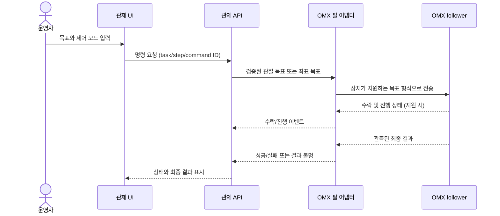

# OMX 로봇팔 좌표 제어 계획

## 목적과 범위

현재 관제는 LeRobot 텔레오퍼레이션 프로세스를 실행합니다. 이 계획은 이를 바탕으로 로봇팔에 목표 자세를 안전하게 전달하는 경로를 단계별로 확인합니다. 우선 관절 목표 자세를 재생하고, OMX 모델에서 기구학과 좌표계가 확인된 뒤에만 말단 좌표(XYZ) 명령을 검토합니다. 카메라 영상에서 물체 위치를 구해 좌표로 바꾸는 작업은 별도 후속 단계입니다.

이 문서는 계획이며 구현 완료나 장치 검증을 뜻하지 않습니다. 현 단계에서는 실제 로봇에 새 명령을 보내지 않습니다.

## 확인된 출발점

- 관제의 팔 실행 경계는 [arm_supervisor.py](../../src/control_station/arm_supervisor.py)이며 `lerobot-teleoperate` 프로세스를 실행하는 텔레오퍼레이션 흐름입니다.
- LeRobot OMX follower 구현의 `send_action`은 모터/관절 목표를 받습니다. 이는 말단 XYZ 목표 API와 다릅니다. [OMX follower 코드](https://github.com/huggingface/lerobot/blob/main/src/lerobot/robots/omx_follower/omx_follower.py)
- LeRobot 문서는 관절 공간과 말단 공간을 구분하고 URDF 기반 IK 예시를 제공합니다. OMX에서 해당 기능을 그대로 쓸 수 있는지와 URDF의 정확성은 별도 확인해야 합니다. [Action representations](https://github.com/huggingface/lerobot/blob/main/docs/source/action_representations.mdx)
- LeRobot의 OMX 예제는 데이터 수집·정책 실행 예제입니다. 범용 XYZ 제어 계약으로 간주하지 않습니다. [OMX examples](https://github.com/huggingface/lerobot/tree/main/examples/omx)
- 관제 저장소만으로는 사용 중인 LeRobot 버전, OMX 관절 이름·한계, 기구학 모델, 말단 좌표계와 완료 판정 계약이 확정되지 않았습니다.
- Head/Joint 카메라 영상이 관제에 도달하는 것과, 카메라 좌표를 로봇 베이스 좌표로 변환하는 것은 별도 기능입니다. 필요한 카메라 보정 및 외부 파라미터는 확인되지 않았습니다.

## 단계별 계획

각 단계는 결과를 확인한 뒤 다음 단계로 넘어갑니다. 단계 1과 이후의 실물 동작 단계는 실제 로봇을 움직이므로, 사용자가 별도로 요청하고 현장에서 감독할 수 있을 때만 수행합니다.

| 단계 | 작업 | 확인 결과 / 다음 단계 진입 조건 |
| --- | --- | --- |
| 0. 인터페이스 조사 | 실제 실행 환경의 LeRobot 경로·버전(commit), OMX 드라이버의 관절 이름·단위·관측/명령 형태, 위치 한계, gripper 인터페이스, 정지 방법, URDF와 기존 IK 지원을 읽기 전용으로 조사 | 장치별 사실과 미확인 항목을 기록. XYZ 목표 지원을 추정하지 않음 |
| 1. 관절 자세 기록 | 기존 leader 조작으로 제한된 수의 안전한 관절 자세를 기록하고 포맷과 재생 도구를 정함 | 목표 관절 값과 출처를 확인. leader 조작 중 follower가 실시간으로 움직일 수 있음을 작업 전 명시 |
| 2. 단일 관절 목표 재생 | 텔레오퍼레이션과 직접 follower 제어를 동시에 열지 않는 단독 제어 경로에서 한 목표 자세만 재생 | 관절 값 제한, 속도 제한, 완료 관측, 취소·정지 결과 확인. 불명확한 결과에서는 다음 명령을 보내지 않음 |
| 3. 오프라인 FK/IK 조사 | OMX 모델과 검증된 URDF로 정기구학/역기구학 계산을 장치 없이 확인. 호환되는 기존 LeRobot 기능이나 라이브러리를 우선 검토 | 프레임, 축 방향, 단위, 관절 한계, 도달 불가 해석을 확인. 모델 검증 전에는 실물 XYZ 이동 금지 |
| 4. 단일 좌표 현장 확인 | 좌표 계약과 정지 절차가 확정된 뒤, 비어 있는 작업 공간에서 감독하에 안전한 단일 목표를 확인 | 요청 좌표와 관측된 말단 위치의 오차를 측정·기록하고 허용 기준을 합의. 실제 장치 시험은 별도 명시적 요청 후 수행 |
| 5. 관제 API 연결 | 검증된 어댑터를 관제의 작업/단계/명령 식별자 및 상태 이벤트에 연결. 텔레오퍼레이션과 좌표 제어 모드의 상호 배제를 구현 | 접수·장치 수락·진행·최종 성공/실패 상태를 구분하고, mock에서 실패·취소·timeout·연결 단절을 확인 |
| 6. 카메라 좌표 연동 | 물체 검출이 제공될 때 카메라 내부/외부 파라미터와 프레임 변환을 정하고 좌표 변환을 연결 | 카메라 위치, 보정, 좌표계, 신선도 및 범위 검사를 통과한 좌표만 명령으로 변환 |

## 제어 흐름 초안

아래는 향후 검증할 흐름입니다. 현재 구현 상태를 나타내지 않습니다.

실제 장치가 진행 상태나 최종 결과를 제공하지 않으면 관제에서 이를 만들어내지 않습니다. 관측 가능한 반환값의 의미를 조사하고, 결과를 확인할 수 없는 경우에는 성공으로 처리하지 않는 계약을 정해야 합니다.

## 좌표 명령 계약에서 확정할 항목

필드 이름과 값 표현은 OMX 인터페이스 조사 후 결정합니다.

- 기준 좌표계(frame): 로봇 base, tool/flange, 카메라 중 무엇인지와 변환 방향
- 위치 단위와 XYZ 축 방향, 오른손/왼손 좌표계 여부
- 말단 방향(orientation)의 표현 방식과 생략 시 동작
- 관절·작업공간 한계, 허용 속도/가속도, 한 명령당 최대 변화량
- gripper 목표와 팔 목표의 결합 여부
- 요청 접수, 장치 수락, 진행, 성공, 실패, 취소, 결과 불명 상태의 출처
- 작업·단계·명령 식별자와 중복·오래된 결과 처리

## 안전 및 완료 기준

- 인터페이스와 실제 지원 단위를 확인하기 전에는 목표를 임의 변환하거나 명령을 보내지 않습니다.
- teleop과 직접 follower 명령은 같은 순간에 함께 동작시키지 않습니다.
- timeout/통신 단절은 정지나 실패를 증명하지 않으므로 자동 재전송하지 않습니다. 결과가 모호하면 개입 필요 상태로 둡니다.
- 이동 완료가 확인되지 않으면 다음 팔 동작이나 작업 단계를 시작하지 않습니다. 물리적 비상정지와 장치 인터록은 관제 UI로 대체하지 않습니다.
- 실물 단계는 감독자, 작업 공간, 실제 정지 절차가 확인되고 사용자가 해당 시험을 요청한 뒤 진행합니다.
- 좌표 제어 기능의 수용은 오프라인 모델 검사, 한 점의 감독된 시험, 요청-결과 추적성, 실패/결과 불명 처리, 재전송 방지로 판단합니다. 위치 허용 오차는 측정 후 합의하며 임의의 수치를 만들지 않습니다.
- 카메라 입력이 오래됐거나 변환 프레임이 불명확하거나 목표가 확인된 작업 범위를 벗어나면 팔 명령을 보내지 않습니다.

## 다음에 필요한 정보

단계 0을 위해 로봇에 연결된 개발 환경에서 다음을 읽기 전용으로 확인합니다.

1. `lerobot-teleoperate`가 설치된 환경의 LeRobot 저장소 경로와 `git rev-parse HEAD` 결과
2. 현재 사용하는 OMX follower/leader 포트 및 ID 설정
3. OMX 모델의 관절 이름, 위치 단위·한계, 관련 URDF 경로와 출처
4. 실물 시험을 계획할 때의 작업 공간과 현장 정지 절차

카메라 좌표를 다루는 단계에서는 Head/Joint 카메라 장치 매핑, 보정값과 물체 위치의 출처를 별도로 확인합니다.
