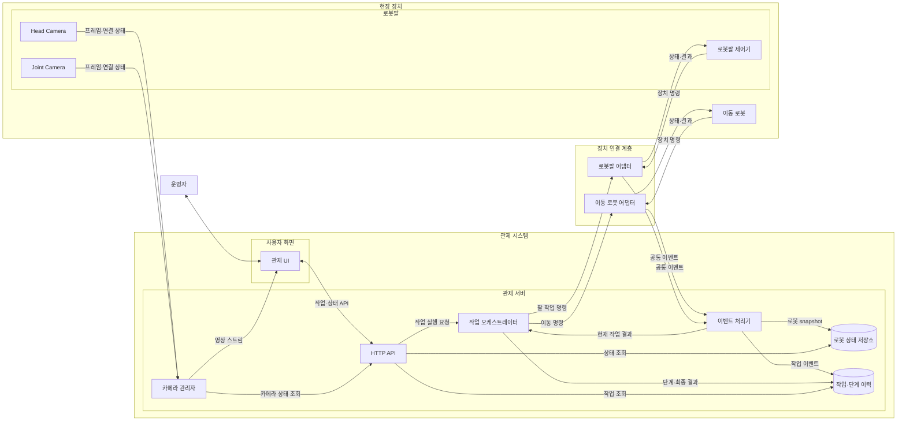
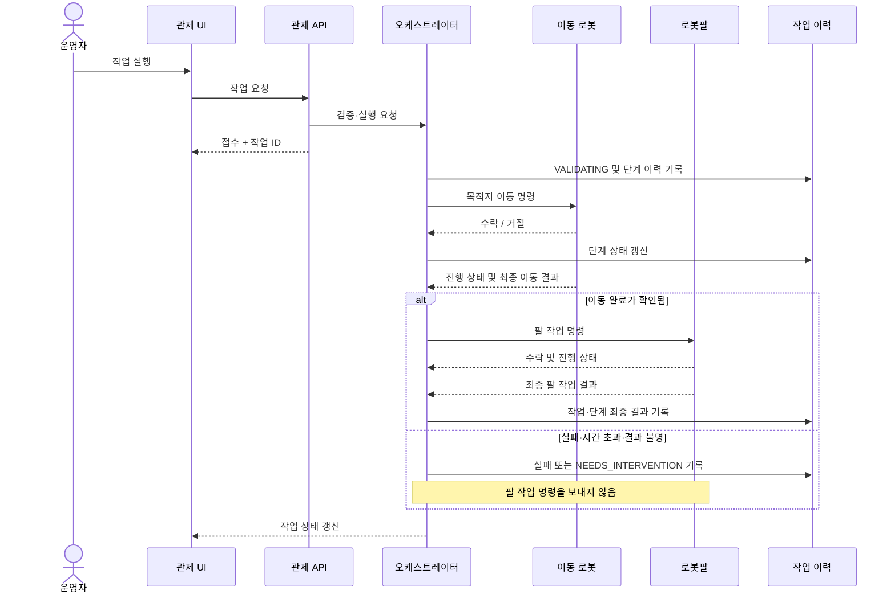
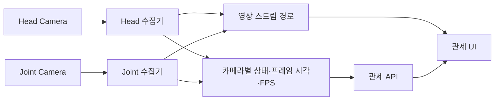

# 목표 데이터 흐름

이 문서는 [시스템 명세](system-spec.md)에 정의한 목표의 흐름만 설명합니다. 현재 코드에서 가능한 요청과 응답은 [구현 현황](../implementation/current-state.md)을 확인하세요.

## 시스템 구성요소

아래 그림은 시스템의 책임 경계와 주요 연결을 보여줍니다. **명령은 오케스트레이터에서 어댑터를 거쳐 장치로 내려가고**, **상태·결과 이벤트는 어댑터에서 관제 서버로 올라옵니다**. 두 카메라는 로봇팔에 장착된 별도 입력이며, 영상 경로는 작업 명령·상태 경로와 분리됩니다.

화살표는 데이터가 전달되는 방향입니다. 이동 로봇과 로봇팔의 장치별 프로토콜은 각 어댑터 안에서 공통 이벤트로 변환합니다. 카메라 영상 자체는 상태 API로 보내지 않고 스트림 경로로 전달하며, API에는 카메라별 연결·프레임 상태만 제공합니다.

## 작업 실행 흐름

## 카메라 영상 흐름

카메라 상태와 로봇 작업 상태는 별도 흐름으로 수집합니다. 프레임은 카메라별 영상 경로로 UI에 전달하고 작업 상태 응답에는 포함하지 않습니다.

## 로봇 이벤트 의미

로봇 어댑터는 작업 식별자를 포함해 명령 수락, 실행 시작, 진행, 성공, 실패, 시간 초과 또는 결과 불명을 보고해야 합니다. 오케스트레이터는 현재 작업과 일치하는 결과만 반영합니다. 프로세스가 살아 있다는 사실만으로 로봇 준비나 작업 완료를 추론하지 않습니다.
