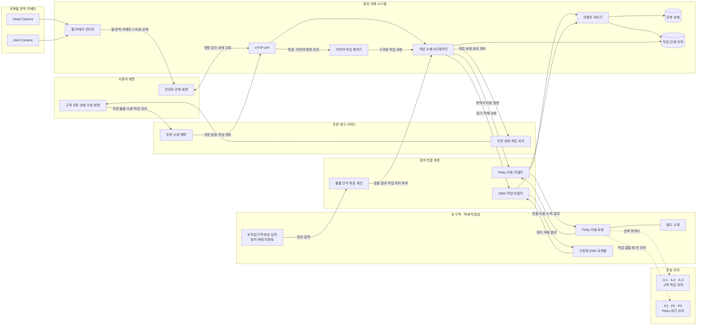
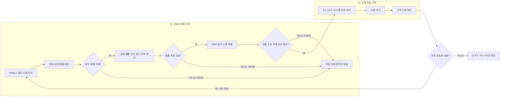
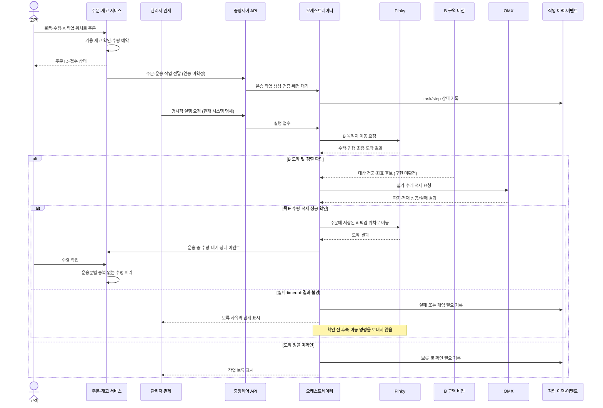

# 목표 데이터 흐름과 시스템 구성

이 문서는 [시스템 명세](system-spec.md)에 정의된 목표를 시각화합니다. 현재 코드가 제공하는 기능은 [구현 현황](../implementation/current-state.md)을 기준으로 확인하세요.

기준 시연 구성과 요구사항은 [Confluence 시스템 요구사항](https://techinwoong.atlassian.net/wiki/spaces/JJJS/pages/1998932/System+Requirements), 문서화 작업은 [JJS-16](https://techinwoong.atlassian.net/browse/JJS-16)을 참고합니다. 아래 그림의 연결선은 논리적인 정보 흐름이며, 장치별 통신 프로토콜이 확인됐다는 뜻은 아닙니다.

## 기본 시연의 구성요소와 역할

기본 구성은 **고정형 OMX 1대, Pinky 1대, Pinky에 연결하는 별도 수레 1대**입니다. OMX가 있는 B 구역에서 수레를 적재하고 고객이 선택한 A-1/A-2/A-3 픽업 위치로 운송합니다. 작업이 없을 때 Pinky는 비어 있는 P1/P2/P3 대기 위치 중 하나로 복귀합니다.

점선은 Pinky의 목적지 선택을 나타내며, 지도·경로 전송 방식은 아직 정해지지 않았습니다. **B 작업구역 영상 입력**은 인식 요구사항을 표시한 논리 구성요소입니다. 로봇팔의 Head/Joint Camera 중 하나와 같은 물리 카메라인지, 별도 카메라인지는 확인되지 않았으므로 서로 합치지 않았습니다.

| 구성요소 | 책임 | 현재 확인 범위 |
|---|---|---|
| 고객 화면·주문 서비스 | 물품/수량 주문, 재고 예약, 픽업 위치 선택, 주문 상태와 수령 확인 | 외부 제품 요구사항. 이 저장소와 연동되지 않음 |
| 관리자 관제 화면·HTTP API | 로봇·카메라·작업 정보 표시, 관제 요청 접수 | localhost 상태 조회, 구조화 작업 이력 생성·조회, mock start/cancel, 픽셀 후보 관측 이력, 팔 수동 텔레오퍼레이션 제어가 구현됨 |
| 자연어 작업 해석기 | 명령에서 물체·색상·선반·목적지를 뽑아 확인 가능한 구조화 초안 생성 | 제한 어휘/문법의 rule-based draft와 폼 채우기 구현; 자연어 이해·모호성 해소는 미구현 |
| 중앙 오케스트레이터 | 주문/작업 조건 확인, Pinky·OMX 단계 순서와 완료 조건 관리 | mock 단계 실행과 저장은 구현됨; 실제 이동·팔 adapter 실행은 미구현 |
| 물품 인식·좌표 계산 | 고정/손목 카메라에서 대상 후보 확인, 3D 위치 및 OMX 목표 계산 | Head Camera YOLO 픽셀 후보 관측, `--arm`과 별도 가중치 설정 시 Joint Camera 재관측 후보, YOLO-World task 관측 POST의 요청 class one-shot prompt, task 감사 이벤트 및 측정값을 입력받는 고정 평면 2D draft 계산 도구까지 구현; 물체별 인식 검증·RGB-D/TF·camera/joint time alignment·카메라→OMX 변환은 미구현 |
| Pinky 어댑터 | Nav2 목적지 요청, 수락·진행·최종 결과를 공통 모델로 변환 | ROS 2 action server 발견만 구현; goal 전송 미구현 |
| OMX 어댑터 | 집기·수레 적재 명령과 완료/실패 결과 변환 | LeRobot 수동 텔레오퍼레이션만 관리; 자동 작업 인터페이스 미확정 |
| 이벤트·상태·이력 | 장치 결과를 해당 작업과 연결해 상태·이력으로 저장 | 작업/단계 상태 저장과 조회 구현; 장치 이벤트 연동 미구현 |
| 팔 카메라 관리자 | 로봇팔 Head/Joint 카메라를 개별 수집하고 UI로 전달 | 두 카메라 경로 설정 및 MJPEG 수집 경로 구현; Head YOLO 입력과 task 관측 이벤트 연결, 별도 가중치 설정 시 Joint detector 및 camera별 step review link 구현. 실장 위치·접근 시점 재인식 동작은 미확인 |

## B ↔ A 운송과 대기 위치

운송 위치와 순서는 요구사항에 따른 목표 흐름입니다. 실제 지도 waypoint, 정차·정렬 센서, 적재 한도, 빈 주차 위치 감지는 장치·현장 확인이 필요합니다. 실패나 미확정 결과에서는 목표 수량을 완료 처리하지 않고 다음 이동을 시작하지 않습니다.

### 실행 trigger 확인 필요

Confluence의 SR-27은 주문 접수 후 운송 작업을 만들고 대기 중인 Pinky에 배정한다고 정의합니다. 이 저장소의 시스템 명세는 작업 생성/배정과 별도로 운영자의 명시적 실행 요청 뒤에 로봇 명령을 보내도록 정의합니다. **작업 자동 배정은 실행 명령 자동 전송과 같은 뜻이 아니며**, 주문 접수 후 실제 주행을 자동 시작할지 운영자 확인을 받을지는 팀 합의가 필요합니다.

## 주문부터 로봇 결과까지의 정보 흐름

이 흐름은 제품 목표이며 mock 작업 start/cancel 및 task 이력 경로는 현재 구현돼 있습니다. mock 실행 결과는 장치 결과가 아닙니다. 실제 Nav2/OMX 명령과 결과, 일반 자연어 이해(제한 parser 초안 제외), 주문/재고 서비스 연결은 구현되지 않았습니다. 현재 관측 경로는 픽셀 후보를 저장하며 작업 상태를 전이하지 않습니다.

## 미확정 기술과 후속 확인

| 항목 | 미확정 내용 | 확인 방법·다음 작업 |
|---|---|---|
| 주문 서비스 연동 | endpoint, 인증, 주문/운송 payload, 상태 소유자 | 주문 서비스 담당자와 API schema·이벤트 책임 합의 |
| B 비전 입력 | 카메라의 실제 장착 위치/장치, Head·Joint 카메라와 관계, 영상 endpoint | 현장에서 카메라 물리 위치와 영상 소스를 대조 |
| 좌표 변환 | source/target frame, 단위, 축, 원점, calibration, 허용 오차 | OMX 제어 입력·카메라 보정 정보를 확인하고 고정된 물품으로 비교 측정 |
| Pinky 이동 | ROS 2 domain/배포판, Nav2 action 이름·타입, map/waypoint, A·B·P 위치 | 로봇에서 ROS graph/action/interface와 지도 좌표 조사 |
| 정차·정렬 | B 도착, 카트 정렬과 작업 허가 판정 신호 | Pinky/수레에 제공되는 센서·상태 인터페이스 확인 |
| OMX 자동 작업 | 명령 형식, READY, 파지·적재 완료, 오류 결과 | 자동 작업용 API/Action과 결과를 제공하는 OMX 인터페이스 확인; 텔레오퍼레이션과 분리 |
| 물량 정책 | 카트 1회 적재 한도, 운송분 분할, 재고 차감 이벤트 | 현장 적재 시험과 주문 정책 합의 |
| 실행 trigger | SR-27의 주문 접수 후 운송 작업 배정과 저장소 명세의 명시적 실행 요청 사이 연결 | 작업 자동 배정 이후 로봇 이동을 자동 시작할지 운영자 요청을 기다릴지 제품·운영 합의 |
| 대기·복구 | P1–P3 점유 감지, timeout/stale 기준, 수동 재개 조건 | 로봇 상태 신호·운영 절차·측정 결과를 토대로 확정 |
