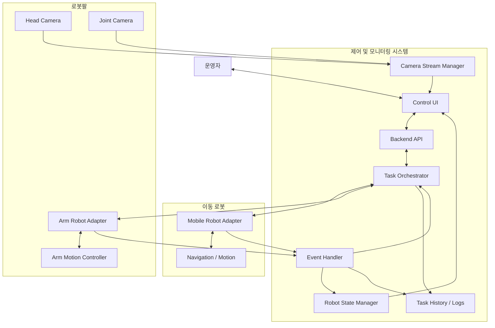
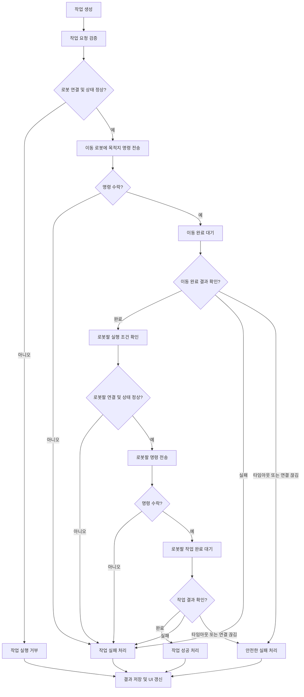
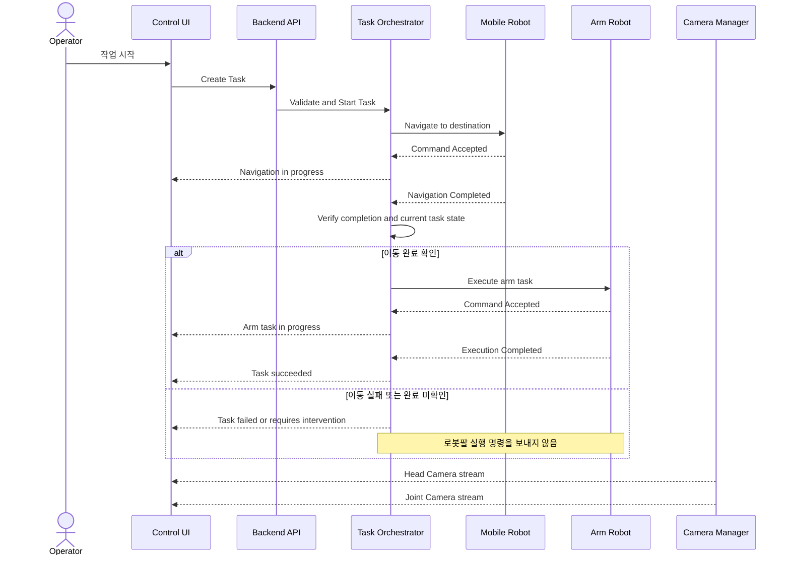

# Robot Control & Monitoring System

## 1. 프로젝트 개요

### 1.1 목적

독립적으로 동작하는 이동 로봇과 로봇팔을 하나의 제어·모니터링 시스템에서 통합 관리한다.

시스템은 작업 순서를 조율하고, 로봇의 실행 상태와 결과를 확인하며, 카메라 영상과 오류 상태를 운영자에게 제공한다.

핵심은 단순히 각 로봇에 명령을 보내는 것이 아니라, **앞선 작업의 실제 완료 여부를 확인한 후 다음 작업을 실행하는 것**이다.

### 1.2 시스템 구성

- **제어·모니터링 시스템**
  - 작업 생성 및 실행
  - 작업 단계별 실행 순서 관리
  - 로봇 상태 및 작업 결과 수집
  - 카메라 영상 및 연결 상태 모니터링
  - 오류 처리 및 실행 이력 관리
- **이동 로봇**
  - 목적지 이동
  - 주행 상태 보고
  - 도착 및 이동 실패 결과 보고
- **로봇팔**
  - 로봇팔 동작 명령 실행
  - 동작 결과 및 오류 상태 보고
  - 머리 위 카메라와 관절 부근 카메라의 영상 제공
- **카메라 2대**
  - Head Camera: 로봇팔 머리 위에 장착된 카메라
  - Joint Camera: 로봇팔 관절 부근에 장착된 카메라

카메라별 영상 수집과 모니터링을 지원하되, 구체적인 인식 기능과 역할은 실제 장비 및 요구사항 확인 후 확정한다.

---

## 2. 확정된 설계 원칙

### 2.1 이동 로봇과 로봇팔은 별도 장비다

두 로봇은 각각 독립적으로 동작하며, 제어 시스템이 두 장비 사이의 작업 순서를 조율한다.

제어 시스템은 각 로봇의 명령 인터페이스를 통해 명령을 전달하고, 결과 이벤트 또는 상태 조회를 통해 실제 진행 상황을 확인한다.

### 2.2 명령 전송과 작업 완료를 구분한다

다음 상태는 서로 다른 의미를 가진다.

1. Command Sent: 명령을 전송했다.
2. Command Accepted: 로봇이 명령을 수락했다.
3. Execution Started: 로봇이 작업을 시작했다.
4. Execution Completed: 로봇이 작업을 완료했다.
5. Execution Failed: 로봇이 작업에 실패했다.

명령을 전송했거나 수락했다는 사실만으로 작업이 완료되었다고 판단하면 안 된다.

### 2.3 이동 완료 확인 전에는 로봇팔을 실행하지 않는다

이동 로봇이 목적지에 도착했다는 명확한 완료 결과를 확인한 경우에만 로봇팔 작업을 시작한다.

다음 상황에서는 로봇팔 작업을 시작하지 않는다.

- 이동 로봇의 주행 실패
- 이동 로봇과의 연결 끊김
- 도착 완료 여부를 확인할 수 없는 상황
- 이동 작업 타임아웃
- 작업 취소
- 이동 로봇의 상태가 불확실한 상황

### 2.4 카메라 연결 상태와 로봇 상태를 분리한다

카메라 영상이 정상적으로 수신된다고 해서 로봇이 정상 상태라고 판단하지 않는다.

반대로 카메라 스트림에 문제가 생겼다고 해서 로봇의 동작이 반드시 중단되었다고 판단하지도 않는다.

카메라 연결 상태, 로봇 연결 상태, 로봇 작업 상태를 각각 관리한다.

카메라 영상이 특정 작업의 필수 조건이 되는지는 추후 별도로 정의한다.

---

## 3. 전체 시스템 아키텍처



### 3.1 주요 컴포넌트 역할

| 컴포넌트 | 역할 |
|---|---|
| Control UI | 작업 실행, 로봇 상태 및 카메라 영상 표시 |
| Backend API | UI 요청 검증 및 제어 시스템 진입점 |
| Task Orchestrator | 전체 작업 순서 및 실행 조건 관리 |
| Robot State Manager | 로봇별 연결 및 실행 상태 관리 |
| Event Handler | 로봇의 상태 변경 및 작업 결과 처리 |
| Camera Stream Manager | 두 카메라의 영상 스트림 및 연결 상태 관리 |
| Mobile Robot Adapter | 이동 로봇의 명령·상태 인터페이스 추상화 |
| Arm Robot Adapter | 로봇팔의 명령·상태 인터페이스 추상화 |
| Task History / Logs | 작업 이력, 결과 및 오류 기록 |

Adapter는 실제 로봇 인터페이스를 시스템 내부의 공통 명령 및 결과 형식으로 변환한다.

실제 통신 방식이 ROS 2, HTTP, WebSocket, SDK 또는 다른 프로토콜인지는 장비 확인 후 결정한다.

---

## 4. 전체 작업 흐름

### 4.1 정상 실행 흐름



### 4.2 반드시 지켜야 할 조건

로봇팔 실행은 다음 조건을 모두 만족해야 한다.

- 이동 명령이 정상적으로 수락되었다.
- 이동 로봇이 이동을 완료했다.
- 완료 결과가 유효한 현재 작업에 대한 결과다.
- 이동 로봇 상태가 불확실하지 않다.
- 로봇팔이 연결되어 있고 실행 가능한 상태다.
- 작업이 취소되거나 실패 처리되지 않았다.

**중요:** 타임아웃이 발생했다는 이유로 이동 명령을 다시 보내거나 로봇팔을 실행하면 안 된다. 실제 로봇 상태를 확인하고, 불확실성이 해소되지 않으면 작업을 중단 상태로 유지해야 한다.

---

## 5. 시퀀스 다이어그램



카메라 영상은 작업 실행 상태와 독립적인 데이터 흐름으로 처리한다. 위 다이어그램은 개념적 흐름이며, 실제 스트림 전송 방식과 영상 경로는 구현 시 결정한다.

---

## 6. 카메라 구성 및 요구사항

### 6.1 카메라 목록

| 구분 | 장착 위치 | 식별자 예시 | 기본 요구사항 |
|---|---|---|---|
| Head Camera | 로봇팔 머리 위 | `head_camera` | 영상 수집, 연결 상태, 영상 표시 |
| Joint Camera | 로봇팔 관절 부근 | `joint_camera` | 영상 수집, 연결 상태, 영상 표시 |

식별자는 예시이며 실제 장비의 명칭과 토픽 이름에 맞춰 변경한다.

### 6.2 카메라 관리 기능

각 카메라에 대해 다음 정보를 관리한다.

- 카메라 식별자
- 장착 위치 및 설명
- 연결 상태
- 영상 스트림 상태
- 마지막으로 정상 수신한 시각
- 프레임 수신 상태 및 프레임률(지원하는 경우)
- 오류 메시지
- 재연결 상태

카메라가 연결되어 있더라도 영상 프레임이 갱신되지 않는 상황을 별도로 감지할 수 있어야 한다.

### 6.3 영상 표시 UI

권장하는 초기 화면은 두 카메라의 영상을 나란히 표시하는 형태다.

```text
┌──────────────────────────────────────────────────────────┐
│ Robot Control & Monitoring                               │
├──────────────────────────────────────────────────────────┤
│ Task Status: RUNNING                                     │
│ Mobile Robot: CONNECTED / NAVIGATING                     │
│ Arm Robot: CONNECTED / IDLE                              │
├─────────────────────────┬────────────────────────────────┤
│ Head Camera             │ Joint Camera                   │
│                         │                                │
│      [Video Stream]     │       [Video Stream]           │
│                         │                                │
│ Status: STREAMING       │ Status: STREAMING              │
├─────────────────────────┴────────────────────────────────┤
│ Current Step: Waiting for mobile robot arrival           │
│ Latest Event: Navigation command accepted                │
└──────────────────────────────────────────────────────────┘
```

### 6.4 영상과 인식 기능의 구분

초기 MVP에서는 영상 수집과 표시를 우선 구현한다.

다음 기능은 실제 요구사항을 확인한 후 추가한다.

- 물체 탐지
- 물체 분류
- 물체 위치 추정
- 좌표 변환 및 카메라 캘리브레이션
- 로봇팔의 물체 접근 위치 계산
- 비전 기반 작업 성공 여부 확인

카메라가 두 대라는 사실만으로 어느 카메라가 물체 인식 또는 정밀 조작을 담당한다고 가정하지 않는다.

---

## 7. 작업 및 상태 모델

### 7.1 전체 작업 상태

| 상태 | 의미 |
|---|---|
| `PENDING` | 작업 대기 |
| `VALIDATING` | 작업 실행 조건 검증 중 |
| `RUNNING` | 작업 진행 중 |
| `SUCCEEDED` | 모든 필수 단계 성공 |
| `FAILED` | 작업 실패 |
| `CANCELING` | 취소 요청 처리 중 |
| `CANCELED` | 취소 완료 |
| `NEEDS_INTERVENTION` | 상태 불확실 또는 운영자 확인 필요 |

상태 전이는 중앙 Orchestrator가 관리한다.

### 7.2 단계별 상태

각 작업은 여러 단계로 구성한다.

예시:

1. `VALIDATE_ROBOTS`
2. `NAVIGATE_TO_DESTINATION`
3. `VERIFY_ARRIVAL`
4. `EXECUTE_ARM_TASK`
5. `VERIFY_ARM_RESULT`
6. `FINALIZE_TASK`

각 단계는 다음과 같은 상태를 가진다.

- `PENDING`
- `COMMAND_SENT`
- `ACCEPTED`
- `RUNNING`
- `SUCCEEDED`
- `FAILED`
- `TIMED_OUT`
- `CANCELED`
- `UNKNOWN`

`UNKNOWN`은 명령 결과를 확인할 수 없을 때 사용한다. 이를 성공이나 실패로 임의 변환하지 않는다.

### 7.3 로봇 상태

각 로봇의 연결 상태와 실행 상태는 별도 필드로 관리한다.

예시:

```json
{
  "robot_id": "mobile_robot_1",
  "connection_state": "CONNECTED",
  "execution_state": "NAVIGATING",
  "last_heartbeat_at": "2026-10-24T10:00:00Z",
  "active_task_id": "task_123"
}
```

위 JSON은 데이터 형식 예시이며, 실제 필드와 시간 형식은 구현 시 결정한다.

### 7.4 카메라 상태

```json
{
  "camera_id": "head_camera",
  "connection_state": "CONNECTED",
  "stream_state": "STREAMING",
  "last_frame_at": "2026-10-24T10:00:00Z"
}
```

`joint_camera`도 동일한 구조로 별도 관리한다.

실제 영상 프레임의 전송 및 저장 방식은 별도로 설계한다. 영상 데이터를 작업 상태 JSON에 직접 포함하지 않는다.

---

## 8. 작업 데이터 모델 초안

### 8.1 Task

```typescript
type TaskStatus =
  | "PENDING"
  | "VALIDATING"
  | "RUNNING"
  | "SUCCEEDED"
  | "FAILED"
  | "CANCELING"
  | "CANCELED"
  | "NEEDS_INTERVENTION";

interface Task {
  id: string;
  status: TaskStatus;
  destination: {
    x?: number;
    y?: number;
    theta?: number;
    frameId?: string;
    waypointId?: string;
  };
  armTask: {
    type: string;
    parameters: Record<string, unknown>;
  };
  createdAt: string;
  startedAt?: string;
  finishedAt?: string;
  errorCode?: string;
  errorMessage?: string;
}
```

좌표계, 목적지 형식 및 로봇팔 작업 파라미터는 실제 장비 인터페이스에 따라 확정한다.

### 8.2 Task Step

```typescript
type StepStatus =
  | "PENDING"
  | "COMMAND_SENT"
  | "ACCEPTED"
  | "RUNNING"
  | "SUCCEEDED"
  | "FAILED"
  | "TIMED_OUT"
  | "CANCELED"
  | "UNKNOWN";

interface TaskStep {
  id: string;
  taskId: string;
  stepType: string;
  status: StepStatus;
  commandId?: string;
  startedAt?: string;
  finishedAt?: string;
  result?: Record<string, unknown>;
  errorCode?: string;
  errorMessage?: string;
}
```

### 8.3 Robot

```typescript
interface Robot {
  id: string;
  type: "MOBILE" | "ARM";
  connectionState:
    | "CONNECTED"
    | "DISCONNECTED"
    | "UNKNOWN";
  executionState: string;
  lastHeartbeatAt?: string;
  activeTaskId?: string;
}
```

### 8.4 Camera

```typescript
interface Camera {
  id: string;
  robotId: string;
  position: "HEAD" | "JOINT";
  connectionState:
    | "CONNECTED"
    | "DISCONNECTED"
    | "UNKNOWN";
  streamState:
    | "STREAMING"
    | "NO_FRAMES"
    | "STOPPED"
    | "ERROR"
    | "UNKNOWN";
  lastFrameAt?: string;
}
```

이 데이터 모델은 구현을 위한 초안이다. 실제 로봇 SDK, ROS 2 메시지, 영상 전송 방식 등을 확인한 후 확정한다.

---

## 9. 오류 처리 및 예외 상황

### 9.1 이동 로봇 오류

| 상황 | 처리 |
|---|---|
| 이동 명령 거부 | 작업 실패 |
| 이동 중 오류 발생 | 이동 실패 처리 및 로봇팔 실행 차단 |
| 이동 타임아웃 | 상태 확인, 필요 시 운영자 개입 |
| 이동 로봇 연결 끊김 | 상태 불확실 처리, 로봇팔 실행 차단 |
| 도착 완료 이벤트 미수신 | 상태 조회 또는 확인 절차 수행 |
| 오래된 완료 이벤트 수신 | 현재 작업과 일치하는지 검증 후 처리 |

### 9.2 로봇팔 오류

| 상황 | 처리 |
|---|---|
| 로봇팔 명령 거부 | 작업 실패 |
| 로봇팔 실행 실패 | 오류 기록 및 작업 실패 |
| 로봇팔 연결 끊김 | 상태 불확실 처리 및 운영자 확인 |
| 완료 이벤트 미수신 | 중복 명령 없이 실행 상태 확인 |
| 로봇팔이 이미 동작 중 | 새 작업 실행 차단 또는 대기 |

### 9.3 카메라 오류

| 상황 | 처리 |
|---|---|
| 카메라 연결 끊김 | 해당 카메라의 연결 상태 표시 |
| 영상 프레임 수신 중단 | 스트림 이상 표시 |
| 영상 스트림 오류 | 오류 기록 및 재연결 정책 적용 |
| 카메라 한 대만 장애 | 다른 카메라의 상태는 독립적으로 유지 |
| 영상 지연 | 마지막 정상 프레임 시각 및 지연 상태 표시 |

카메라 장애가 작업 중단 조건인지 여부는 해당 작업에서 카메라가 필수 조건인지에 따라 결정한다.

### 9.4 중복 명령 및 이벤트

다음 상황에 대비한다.

- 같은 작업이 두 번 시작되는 경우
- 네트워크 재시도로 같은 명령이 중복 전달되는 경우
- 이전 작업의 완료 이벤트가 늦게 도착하는 경우
- 명령 응답은 없지만 로봇은 이미 실행 중인 경우
- UI에서 취소했지만 로봇이 아직 동작 중인 경우

이를 위해 `taskId`, `stepId`, `commandId`를 사용하고, 가능한 경우 명령 멱등성과 중복 실행 방지 정책을 구현한다.

명령 결과가 불확실할 때는 동일 명령을 무조건 재전송하지 않는다.

### 9.5 안전 관련 원칙

소프트웨어의 작업 순서 제어만으로 물리적인 안전을 보장할 수는 없다.

비상 정지, 충돌 방지, 작업 영역 제한 및 로봇별 안전 기능은 장비에서 지원하는 안전 메커니즘을 우선 활용한다.

---

## 10. 관제 UI 요구사항

### 10.1 필수 화면

#### A. 전체 모니터링 화면

- 이동 로봇 연결 상태
- 이동 로봇의 현재 상태 및 목적지
- 로봇팔 연결 상태
- 로봇팔의 현재 동작 상태
- Head Camera 영상
- Joint Camera 영상
- 현재 작업 상태
- 현재 실행 단계
- 최근 오류 및 이벤트

#### B. 작업 제어 화면

- 목적지 입력 또는 선택
- 로봇팔 작업 유형 선택
- 작업 파라미터 입력
- 작업 시작
- 작업 취소
- 단계별 진행 상황
- 최종 결과

#### C. 작업 이력 화면

- 작업 ID
- 시작 및 종료 시각
- 목적지
- 단계별 결과
- 실패 원인
- 작업 재조회

실제 재실행 기능은 이전 작업의 안전한 재실행 가능 여부를 검증한 후 추가한다.

### 10.2 상태 표시 예시

```text
Task: task_123
Status: RUNNING

1. Validate robots          SUCCEEDED
2. Navigate to destination  RUNNING
3. Verify arrival           PENDING
4. Execute arm task         BLOCKED
5. Verify arm result        BLOCKED

Mobile Robot: CONNECTED / NAVIGATING
Arm Robot: CONNECTED / IDLE

Head Camera: CONNECTED / STREAMING
Joint Camera: CONNECTED / STREAMING
```

이동이 완료되기 전까지 로봇팔 단계는 `BLOCKED` 또는 이에 준하는 대기 상태로 표시한다.

---

## 11. MVP 범위

### 11.1 MVP에 포함

- [ ] 이동 로봇 연결 및 상태 확인
- [ ] 로봇팔 연결 및 상태 확인
- [ ] 목적지 이동 명령 전송
- [ ] 이동 명령 수락 여부 확인
- [ ] 이동 완료 결과 확인
- [ ] 이동 실패 시 로봇팔 실행 차단
- [ ] 이동 타임아웃 및 연결 끊김 처리
- [ ] 이동 완료 후 로봇팔 명령 전송
- [ ] 로봇팔 실행 결과 확인
- [ ] Head Camera 영상 수집 및 표시
- [ ] Joint Camera 영상 수집 및 표시
- [ ] 카메라별 연결 및 스트림 상태 표시
- [ ] 작업 단계별 상태 표시
- [ ] 작업 이력 및 오류 로그 저장
- [ ] 중복 작업 실행 방지

### 11.2 추후 검토

- [ ] 비전 기반 물체 인식
- [ ] 카메라 캘리브레이션
- [ ] 카메라 영상 기반 좌표 추정
- [ ] 영상 분석 결과를 이용한 작업 계획
- [ ] 다중 작업 큐 및 우선순위
- [ ] 여러 이동 로봇 또는 로봇팔 지원
- [ ] 사용자 권한 및 감사 로그
- [ ] 장시간 작업 모니터링 및 알림

---

## 12. 테스트 시나리오

### 12.1 정상 동작

1. 작업을 생성한다.
2. 이동 로봇에 목적지 명령을 보낸다.
3. 명령 수락을 확인한다.
4. 이동 완료 이벤트를 수신한다.
5. 해당 이벤트가 현재 작업에 대한 결과인지 확인한다.
6. 로봇팔에 작업 명령을 보낸다.
7. 로봇팔 작업 완료를 확인한다.
8. 전체 작업을 성공 처리한다.

### 12.2 이동 실패

1. 이동 명령을 보낸다.
2. 이동 로봇이 실패를 반환한다.
3. 전체 작업을 실패 처리한다.
4. 로봇팔 명령이 전송되지 않았음을 확인한다.

### 12.3 이동 완료 미확인

1. 이동 명령을 보낸다.
2. 이동 로봇의 완료 이벤트가 도착하지 않는다.
3. 타임아웃을 발생시킨다.
4. 실제 상태를 확인하거나 운영자 개입을 요청한다.
5. 로봇팔 명령이 전송되지 않았음을 확인한다.

### 12.4 이동 로봇 연결 끊김

1. 이동 중 연결을 끊는다.
2. 연결 이상을 감지한다.
3. 작업을 실패 또는 개입 필요 상태로 전환한다.
4. 로봇팔 작업이 시작되지 않았음을 확인한다.

### 12.5 로봇팔 실패

1. 이동 완료를 확인한다.
2. 로봇팔 명령을 전송한다.
3. 로봇팔이 실패를 반환한다.
4. 작업 결과 및 오류를 기록한다.

### 12.6 카메라 장애

1. Head Camera의 스트림을 중단한다.
2. Head Camera 상태가 오류 또는 프레임 미수신 상태로 변경되는지 확인한다.
3. Joint Camera의 상태가 독립적으로 유지되는지 확인한다.
4. 카메라 장애가 해당 작업의 필수 조건에 따라 처리되는지 확인한다.

### 12.7 중복 실행

1. 같은 작업의 시작 요청을 연속으로 보낸다.
2. 중복 작업이 실행되지 않는지 확인한다.
3. 이전 작업의 늦은 완료 이벤트가 새 작업을 잘못 완료 처리하지 않는지 확인한다.

---

## 13. 구현 완료 기준

다음 조건을 충족하면 초기 MVP를 완료한 것으로 본다.

1. 이동 로봇과 로봇팔을 각각 제어할 수 있다.
2. 이동 로봇의 실제 완료 결과를 확인한 뒤에만 로봇팔 작업을 실행한다.
3. 이동 실패, 타임아웃 또는 연결 불확실 상황에서 로봇팔 작업을 실행하지 않는다.
4. 명령 전송, 수락, 실행, 완료 상태가 구분된다.
5. Head Camera와 Joint Camera의 영상을 각각 확인할 수 있다.
6. 카메라별 연결 상태와 영상 스트림 상태를 구분할 수 있다.
7. 각 작업의 단계별 결과 및 오류를 추적할 수 있다.
8. 중복 명령과 오래된 이벤트에 대한 기본 방어 로직이 존재한다.
9. 주요 정상·실패 시나리오가 테스트되어 있다.

---

## 14. Codex를 통한 개발 진행 지침

이 문서는 새로운 프로젝트의 초기 요구사항 및 설계 초안이다.

기존 코드베이스가 있다고 가정하지 않는다. 사용자가 제공하는 참고 프로젝트를 먼저 분석하고, 그 결과를 바탕으로 새 프로젝트의 기술 스택과 구조를 결정한다.

### Phase 1. 참고 프로젝트 분석 및 설계

**이 단계에서는 코드를 작성하거나 기존 파일을 변경하지 않는다.**

수행할 작업:

1. 참고 프로젝트의 디렉터리 구조 확인
2. 기술 스택 및 주요 의존성 확인
3. 로봇 제어 인터페이스 및 통신 방식 확인
4. ROS 2 사용 여부 및 배포판 확인
5. 카메라 영상 수집 및 표시 방식 확인
6. 재사용 가능한 코드와 새로 구현할 영역 구분
7. 전체 아키텍처 및 작업 흐름 설계
8. 데이터 모델과 상태 전이 정의
9. 오류 처리 정책 설계
10. 단계별 구현 계획 수립

분석 결과는 다음 순서로 보고한다.

- 확인된 사실
- 아직 확인되지 않은 사항
- 재사용 가능한 코드 및 구성요소
- 권장 기술 스택과 선택 이유
- 전체 아키텍처
- 작업 순서도 및 시퀀스 다이어그램
- 데이터 모델
- 주요 실패 시나리오
- 단계별 구현 계획
- 사용자에게 확인할 질문

참고 프로젝트에서 확인되지 않은 내용은 추측으로 확정하지 않는다.

### Phase 2. 설계 승인 후 구현

설계안을 검토하고 승인한 후에만 코드를 작성한다.

권장 구현 순서:

1. 프로젝트 기본 구조 구성
2. 로봇별 Adapter 인터페이스 구현
3. 이동 로봇 연결 및 상태 확인
4. 이동 명령 및 완료 확인 로직 구현
5. 로봇팔 연결 및 작업 실행 로직 구현
6. 작업 오케스트레이션 및 상태 머신 구현
7. 카메라 2대의 영상 수집 및 상태 관리 구현
8. 관제 UI 구현
9. 작업 이력 및 오류 로그 구현
10. 예외 처리 및 테스트 추가
11. 실제 장비 또는 시뮬레이터를 통한 검증

### Phase 3. 통합 테스트

- 이동 성공 후 로봇팔 실행
- 이동 실패 시 로봇팔 실행 차단
- 연결 끊김 및 타임아웃 처리
- 중복 실행 방지
- 카메라별 영상 및 상태 확인
- 작업 결과와 UI 상태 일치 여부 검증

실제 하드웨어에서 실행하기 전에는 시뮬레이터 또는 모의 Adapter를 이용해 핵심 흐름을 검증하는 방안을 우선 검토한다.

---

## 15. 추가 확인이 필요한 사항

다음 항목은 구현 전에 확인해야 한다.

### 로봇 및 통신

- 이동 로봇의 모델 및 제어 인터페이스
- 로봇팔의 모델 및 제어 인터페이스
- ROS 2 사용 여부와 배포판
- 명령 전송 및 완료 이벤트 형식
- 연결 상태와 로봇 상태를 조회하는 방법

### 카메라

- Head Camera의 모델과 영상 접근 방법
- Joint Camera의 모델과 영상 접근 방법
- 카메라별 해상도 및 프레임률
- 영상 스트림 프로토콜
- 두 카메라의 캘리브레이션 여부
- 카메라 영상이 필수인 작업과 선택적인 작업의 구분
- 각 카메라를 물체 인식이나 위치 추정에 사용할 계획이 있는지

### 작업 흐름

- 목적지를 좌표로 입력할지, 사전에 정의된 waypoint로 선택할지
- 로봇팔에 전달할 작업 유형과 파라미터
- 작업 취소 시 실제 로봇에 정지 명령을 보낼지
- 타임아웃 및 재시도 정책
- 실제 장비와 시뮬레이터 중 어느 환경부터 지원할지

---

## 16. 최종 설계 원칙 요약

- 제어 시스템은 이동 로봇과 로봇팔의 작업을 조율한다.
- 이동 로봇과 로봇팔은 독립적인 장비로 취급한다.
- 이동 완료를 확인하기 전에는 로봇팔을 실행하지 않는다.
- 명령 전송과 실제 작업 완료를 구분한다.
- Head Camera와 Joint Camera를 별도 카메라로 관리한다.
- 카메라 영상과 로봇 상태를 독립적으로 추적한다.
- 인식 기능과 카메라별 역할은 확인된 요구사항에 따라 설계한다.
- 오류나 상태 불확실 상황에서 성공으로 간주하거나 다음 작업을 무조건 실행하지 않는다.
- 참고 프로젝트를 먼저 분석하고, 설계 승인 후 구현한다.